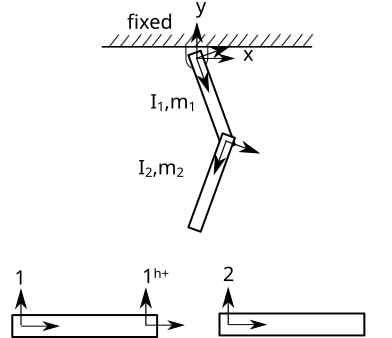
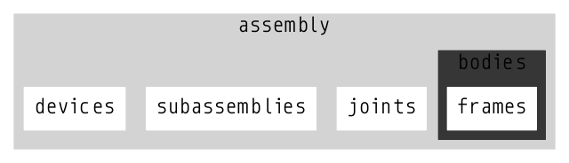
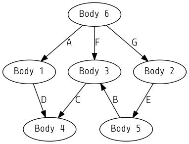

.. title:: The Design of STAR 2.0

The Design of STAR 2.0: A Simulation Tool for Automation and Robotics
=====================================================================

Abstract
--------

This section discusses the various file formats and data structures used in a new simulation software package for general purpose world modeling of robotics and manufacturing applications.

Introduction
------------

Industrial robots are commonly programmed using joysticks, touchpads or *teach pendants* to position a robot to execute a given task. Another popular programming technique is the *lead-by-the-nose* method, where a robot's joints are controlled to go limp, and a user guides the end effector to varying poses, which are recorded for later playback. A disadvantage to these "online" programming techniques on a physical robot is that trying out multiple arrangements of robots and/or workpieces in a manufacturing environment may require relocating heavy equipment, which may be expensive and time consuming.

First proposed in the early 1980s by Brooks and others :cite:`lozano1984`, the field of *automatic programming* is now finding many applications in industrial automation due to increases in computing power and sensor resolution. In automatic programming, only higher level tasks are assigned to a robot and the path planning and manipulation strategies are coordinated by the robot itself, rather than computed a priori by a human operator. Particularly with large industrial robots, experimental "online" automatic programming algorithms pose risk of injury or damage to factory equipment, to humans in proximity of the workcell and to the robot itself.

Due to the inherent risks and challenges associated with manual and automatic online robot programming, "offline" model-based programming tools serve an important role in factory planning and robotics design. STAR (A Simulation Tool for Automation and Robotics) :cite:`ravani1988star,hornick1986data,hornick1986computer`, was one of the pioneering general purpose world modeling programs to use 3D computer graphics to lay out virtual robots and workcells. The aims of original STAR software were to:

    * Provide flexibility to accommodate a wide range of robots and workcell configurations.
    * Provide tools to add or remove robots and objects from the environment
    * Allow the assignment/reassignment of target locations
    * Provide the ability to command robot motions in varying coordinate frames
    * Allow a robot to interact with objects in its workspace
    * Allow modeling multiple devices in parallel
    * Display geometric shape information created in an external modeling program.

There are presently several software tools that achieve the original objectives of STAR v. 1.0, such as RobotMaster :cite:`robotmaster`, Gazebo :cite:`koenig2004`, Tecnomatix :cite:`tecnomatix` and others. Certainly, there have been many advances in technology since the original version of STAR, including considerable increases in computing capacity, a proliferation of development tools for programming and visualization, and the explosive growth of the world-wide-web (and more recently, the *internet of things*). With these  developments in mind, the authors are developing a new free and open source version of STAR (version 2.0). This article describes the design of the new STAR 2.0 software.

The Aims of STAR 2.0
--------------------

In addition to the features outlined above, the aims of STAR 2.0 are summarized below, and described in further detail later in the article:

    * Compatibility with modern web technologies

        - File formats are based on the JSON :cite:`bray2014javascript` (Javascript Object Notation) file format designation.

    * Numerical efficiency

        - A built-in physics engine solves a system of dynamics equations using a minimal set of independent generalized coordinates
        - A custom vectorized, sparse kinematics library minimizes floating point operations and increases throughput
        - A graph partioning algorithm called *kinematic substructuring* automatically identifies and uncouples non-overlapping, intersecting groups of chord loops :cite:`wehage2015generalized` and block diagonalizes the Jacobian matrix, resulting in increased numerical efficiency
        - Implements Algorithm Optimizing Processing (AOP) to minimize pointer dereferences
        - The core solver is programmed entirely in the C programming language to minimize application overhead (such as for garbage collection)

    * Memory and cache efficiency

        - Computational quantities are moved into aligned, contiguous memory to minimize cache misses
        - Extensive use of memory profiler to ensure no memory leaks

    * Robustness

        - Automatically sets up and solves dynamic equations even for highly complex, parallel mechanisms using graph theoretic methods
        - Automatically identifies optimal generalized coordinates using Generalized Coordinate Partitioning (GCP) :cite:`wehage1982`

    * Extensibility

        - An application programming interface (API) in the C programming language is provided
        - Compatibility with the Robot Operating System (ROS) :cite:`quigley2009ros` message passing interface

Data Structures
---------------

External File Format
********************

STAR 2.0's external file format is designed from the outset to be compatible with web technologies. The ASCII text-based file format is based on the JSON (Javascript Object Notation) specification, a subset of the Javascript programming language :cite:`bray2014javascript`. JSON is a lightweight, programming language independent syntax that is faster to process than XML :cite:`nurseitov2009comparison`. JSON is a common data exchange format for web services and is a native file format representation in NoSQL databased such as CouchDB and MongoDB.

The JSON language format has a number of advantages. JSON files are programming language independent - parsers exist in many programming languages. STAR 2.0 uses the Jansson C library for reading/writing JSON files :cite:`jansson`. The simple syntax allows users to manually generate their models in a text editor, using STAR 2.0's C programming API, or interactively using a graphical user interface. Power users can also develop STAR JSON files in a scripted fashion using their preferred programming language. A complete

A simple double pendulum model, as illustrated in :num:`Fig. #double-pendulum` below is used to demonstrate the STAR JSON syntax.

.. _double-pendulum:

    Double Pendulum Model

The accompanying STAR JSON file is shown below:

.. literalinclude:: double_pendulum.star
    :language: json

The various aspects of the STAR JSON file are described in detail below:

The *fixed* key at the root level of the STAR JSON file represents the fixed inertial reference frame and contains only frames (i.e. coordinate systems) and lights -- i.e. no bodies or joints. If no lights are specified, a directional overhead light in the opposite direction of gravity is specified for rendering. If the *fixed* field is not present, a fixed inertial reference frame with only an "origin" reference frame is loaded.

Statically positioned *lights* may be specified by specifying the parent to the name of a frame within the *fixed* field. Moving lights can be specified by setting the parent frame to a frame on a moving body.

Each entry under the *bodies* field contains a unique name and information related to mechanism topology (i.e. shape matrices :cite:`uicker2013`) and mass/inertia properties. Body geometry is specified in an external 3D file. STAR 2.0 uses the Assimp Open Asset Import library :cite:`assimploader` for loading body geometry which supports loading of a variety of 3D file formats.

Each entry under the *frames* field contains a unique name and a shape matrix specified as a 3x3 SO3 rotation matrix and a translation vector from the body origin. Again it is not necessary to specify an "origin" reference frame, as with the fixed inertial reference frame, by default every body contains the "origin". Therefore, the name "origin" is a reserved keyword that cannot be used as a reference frame name at any level.

The *joints* field contains connections between frames. Each joint has a unique name, a type, an initial position and velocity, and a body-frame pair. Currently the following joint types are supported: primitive rotations (i.e. "Rx", "Ry", and "Rz"), primitive translations (i.e. "Tx", "Ty", and "Tz"), "rigid" connections used to rigidly position two bodies together, and 6DOF "float" joints, which are used to initially position a body that is not explicitly connected to the inertial reference frame. Support for compound joints such as planar, spherical, universal and gears is planned for a later version of STAR.

Springs, dampers and friction are specified under the *restraints* field. A restraint has a unique name, a type, knot points, coefficients, and either a joint name (if the restraint is aligned with a joint variable) or a body frame pair. Torsional springs and torsional dampers must must be associated with a joint and its joint variable, but linear springs and dampers may be specified as either associated with a translational joint variable or as a body-frame pair. In the latter case, an additional field for "distance_type" may be specified. If no setting for distance type is set, the program will assume the Euclidian distance between parent and child frames should be used. Otherwise, it is possible to set the distance as aligned with the x, y or z axis of the parent frame as:

.. code-block:: javascript

    "restraint": {
      "type": "spring",
      "body_frame_pair": [
        ["body1", "1h_plus"],
        ["body2", "origin"]
      ],
      "distance_type": "Tz",
      "knot_points": [0],
      "coefficients": [[2, 0.5, 0], [0]]
    }

A spring, damper or frictional restraint may be set as a piece-wise, nonlinear function of the joint's displacement or velocity by setting knot points and arrays of coefficients. The number of coefficient arrays must be one greater than the number of knot points. For example, in the above example, the piecewise function evaluates to:

.. math::

    f(\phi) =  \begin{cases}
    2\phi^2 + 0.5\phi<0 \\
    0 & otherwise
    \end{cases}

Such a piecewise discontinuous function might be used as a basis for modeling tire deflection, for example. Support for setting up more complex, user-defined force-modules is planned for a future release of STAR.

The *assemblies* field contains any number of bodies and joints. In the double pendulum example, bodies "link1" and "link2" are assigned to the "double_pendulum" assembly. Although the pendulum consists of a single assembly, multiple assemblies could be inserted at the top level and any number of subassemblies can be inserted into other assemblies, nested arbitrarily deep.

Joints in one assembly can connect bodies in different assemblies/subassemblies by specifying the full path to the body in the assembly hierarchy. The ":" character is used to specify the position within an assembly hierarchy, and is therefore not a valid character to use in a descriptive name. For example,  "factory:workcell1:robot2:body1:frame1", indicates "frame1" on "body1" in the "robot2" subassembly, which is contained within the "workcell1" subassembly, which is in turn a member of the "factory" main assembly. If no path is specified, the program searches for descriptive names only within the local assembly.

Organizing models into assemblies is a concept which should be familiar to most users of CAD software. The hierarchical organization structure facilitates model reuse and rapidly building complex models from simpler models. For example, a main assembly might contain an entire factory environment, with a number of subassemblies containing robotic workcells. In turn, each workcell may each contain a number of robots or workpieces specified in their own subassemblies. Additionally, assemblies can be switched on or off to facilitate design sensitivity studies with minimal changes to the file.

Thus far, discussion has focused on datastructures related to the geometry and topology of a multibody system, much of which can be derived from a user's CAD software. The missing component necessary for robotics is the ability to interact with the model. In STAR 2.0, this interaction is achieved through a *Device* datastructure. A *Device* datastructure contains pointers to one or more joints which the user can read encoder values from or set forces, positions, velocities or accelerations. Any joint that is a member of a device is exposed as an ROS "topic", to which other ROS nodes can subscribe. Refer to :cite:`quigley2009ros` for more details on the Robot Operating System.  Additionally, a Device datastructure contains pointers to one or more sensors for contact, LIDAR, RADAR and cameras, which are attached to Frames on Body datastructures. Similarly, the output of these sensors are made available as ROS "topics". Note that in the original STAR v 1.0 software, a distinction was made between "Objects" and "Devices". In STAR 2.0, no such distinction is made. *Intelligence* is embodied in an object simple by creating one or more Device datastructures, with no modifications to the underlying model and datastructures.

Internal Data Structures
************************

When the STAR JSON file is loaded from disk into working memory, it is imported into a linked-list datastructure (also known as a ring datastructure :cite:`hornick1986data`). The descriptive names in the body-frame pairings are matched to set the appropriate memory pointers. The linked-list representation is used primarily for programming convenience, as it allows allocating memory for model primitives on an as-needed basis. For example, the linked-list enables a user to interactively add or remove objects from their model. Note that the linked-list representation of the model is not used for computationally intensive/demanding tasks -- aspects which are discussed later in the article.

Models are defined using the following primitives:

    * frames (coordinate systems)
    * bodies

        - *Frames* linked list

    * springs
    * dampers
    * joints
    * sensors
    * devices

        - *Sensors* linked list
        - *Joints* linked list

    * assemblies

        - *Restraints* linked list
        - *Bodies* linked list
        - *Joints* linked list
        - *Devices* linked list
        - "Subassemblies" linked list

    Schematic of Assembly Datastructure

In addition to the data specified in the STAR JSON file, a *Body* datastructure a reference frame, which may not be the origin of the body. Additionally, the body contains the geometric data loaded from the model geometry defition, such as the vertices, faces, and colors and textures.

The *Frame* datastructure contains a SE3 matrix that specifies an orientation and translation relative to a body's origin :cite:`selig2005geometric`.

In addition to the terms specified in the STAR JSON file, a *Joint* datastructure contains joint properties necessary for processing the equations of motion, such as the influence coefficient matrices :cite:`murray1994mathematical`, current joint position, velocity and acceleration. For more information on the directed graph representation of a multibody system, the reader is referred to :cite:`uicker2013`.

In the C programming language, bodies and joints can be represented using structs and the connections between them as memory pointers:

.. code-block:: c

    typedef struct Frame {

      ...

    }

    typedef struct Body {

      ...

    }

    typedef struct Joint {

      ...

      Body* parentBody;
      Frame* parentFrame;

      Body* childBody;
      Frame* childFrame;
    }

Dual Graphs
------------

Directed Acyclic Graphs vs. Directed Graphs
*******************************************

The body-joint-body representation described above will be familiar to most modern CAD users and engineers, whereas concepts like *scene graphs* or *spanning trees* are less familiar. However, by building the a multibody system's *topology* from bodies and joints, the user has -- perhaps unknowingly -- generated a directed acyclic graph (DAG) representation of their system with bodies as nodes as joints as edges. For example, consider the hydraulic clamp mechanismm in Fig 2. below.

.. figure:: hydraulic_clamp.png
    :width: 500px
    :align: center

    Hydraulic Clamp

Its directed acyclic graph is shown in Fig. 3.

    Directed Acyclic Graph (DAG)

While the DAG representation of the mechanism is convenient for the user to visualize the topology, it does not provide a systematic means to update the kinematics and dynamics of the system. For example, there are multiple paths in the DAG to update the position and orientation of bodies 3 and 4.

To resolve this ambiguity, it is necessary to identify the *spanning tree* of the mechanism, i.e. the set of graph edges that touch every node exactly once. This process requires identifying the set of arcs and chords of the directed graph as shown in Fig. 4. For a comprehensive discussion automatic methods to obtain the set of arcs and chords of an acyclic directed graph, refer to :cite:`wehage2015generalized,uicker2013`.

In this example, the arcs of the directed graph are shown in black and the chords are shown in blue. Note that the sense of joint B (shown in red) has also been flipped to align with the spanning tree. If the chords of the graph are removed, each body will have a unique parent body and associated joint.

.. figure:: directed_acyclic_graph2.png
    :width: 300px
    :align: center

    Directed Acyclic Graph with Arcs and Chords identified

In STAR 2.0, the instructions to update the topology of a multibody system are coded using function pointers. Function pointers are a powerful tool in the C programming language which allow calling specific functions at program run-time based on definitions supplied in a user's model definition. For example, in STAR 2.0, if a user has specified a joint as a revolute joint about the X-axis, a function pointer to a vectorized, sparse matrix multiplication for a rotation about the x axis is called. Note that this dynamic building of a program from a model definition is sometimes referred to as *Automata based programming* :cite:`booth1967sequential` and is used by other model based programming languages such as the Unified Modeling Language (UML) :cite:`rumbaugh2004unified`.

If a function pointer for each Body and Joint is set in each data structure as:

.. code-block:: c

    typedef struct Body {

      ...

      void* bodyFunctionPointer(Body*); // update shape matrices

      int childCount;
      Joint** childJoints;
    }

    typedef struct Joint {

      ...

      void* jointFunctionPointer(Joint*); // updates influence coefficient
                                          // matrices, accelerations,
                                          // velocities, relative values across
                                          // joints, etc.
      Body* parentBody;
      Frame* parentFrame;

      Body* childBody;
      Frame* childFrame;
    }

Once a function pointer is set for each body and joint based on the number of shape matrices and type of joint, the mechanism topology can be updated using recursion using the following C code.

.. code-block:: c

    void RecursiveTreeTraversal(Body* body) {

      body->bodyFunctionPointer(body); // update shape matrices

      // process children
      for(int i = 0; i < body->childCount; i++) {
        body->childJoints[i]->jointFunctionPointer(body->childJoint[i]);
        RecursiveTreeTraversal(body->childJoint[i]->childBody);
      }
    }

    // then call the recursive function as
    Body* fixed;
    RecursiveTreeTraversal(fixed);

Note, however, that there are a number of disadvantages with this approach:

    * Chords D and E are not updated. Additional logic is required to process properties related to chord joints
    * This approach involves many pointer dereferences that the compiler will not be able to optimize away as there is no way for the compiler to know the body-joint-body sequence ahead of time
    * Recursion is memory inefficient and slow
    * Traversing a linked list datastructure in fragmented memory is cache-inefficient.
    * By removing joints D and E from the graph, the user's original acyclic representation is lost

Dual Graph Representation
*************************

To address these disadvantates, STAR 2.0 takes a slightly different approach to process and update the system's topology. In STAR 2.0, the user's original directed acyclic graph shown in Fig. 2 is maintained, and a second *dual* directed graph is created. Each time the user adds or removes a body or joint, memory for the second directed graph is freed and a new graph is generated automatically. Instead of removing joints from the user's original DAG representation, additional massless *virtual* bodies (shown in octagons) are added and constraints (shown as a dashed blue lines) are imposed as shown in Fig. 5 below.

.. figure:: directed_graph.png
    :width: 600px
    :align: center

    Dual Directed Graph representation

An important aspect in this process is that memory is allocated for quantities required to update the mechanism's topology based on the total number of *active* bodies, joints and frames in the system. Data are then copied by value from their position in the directed acyclic graph representation to the *dual* directed graph representation and the memory pointers in each of the bodies and joints are updated to point to the new locations. Quantities required to process the kinematics and dynamics of the system are now stored in contiguous, closely-packed memory in a *struct of arrays* (SOAs), which serves to minimize cache misses. Note that great care has been taken using a memory profiler to ensure that there are no memory leaks when the second dual directed graph representation is created or freed.

If STAR detects that the sense of the joint should be flipped in the directed graph representation to align with the spanning tree (as in the above example), the inverse transformation is set automatically in the appropriate position in the function pointer array, so as to maintain the user's originally defined sense.

The second *dual* graph representation is completely transparent to the user. The user can access body and joint parameters through their orginal linked-list Directed Acyclic Graph representation within each assembly using the C-API or through the graphical user interface. The assemblies serve to organize the pointers to bodies, joints, frames, devices and other objects, but are not represented in dual graph. Another advantage to the dual graph representation is that data exists in only one location. As the kinematics and dynamics of the mechanism are updated, there is no need to copy data by value back to a second datastructure. An example mechanism is shown in a screen shot of the STAR 2.0 graphical user interface. The assembly hierarchy, displayed at the left of the viewport, is generated using recursion from the linked-list model representation.

.. figure:: screenshot.png
    :align: center

    Screenshot of STAR 2.0 Program showing hydraulic excavator

Algorithm Optimizing Processing
-------------------------------

One well-known method to reduce the overhead associated with traversing the spanning tree is the Parent-Child List :cite:`featherstone2008rigid`. See also :cite:`wehage2015generalized`. A Parent-Child list is an array equal to the number of nodes in the spanning tree. Bodies are reordered in monotically increasing level order and joints are reordered such that each body's unique parent joint is found at the corresponding body index. While this technique offers performance advantages over the recursive method described above, there are still a number of pointer dereferences required to find the corresponding frames located on each body, which can be improved.

In STAR 2.0, the Parent-Child list is used to generate an array of pointers to values in their respective arrays. These pointer arrays are then sent to an array of function pointers, which processes and stores the values in their respective locations. Using this technique, it is not necessary to set a joint's function pointer within a joint datastructure as above. Instead, an array of function pointers is created in the dual representation as:

.. code-block:: c

    int functionPointerCount;
    void* functionPointer(double** dataPointer);
    double*** dataPointer;

The logic for traversing the spanning tree is now significantly reduced, as illustrated in the below code:

.. code-block:: c

    for(int i = 0; i < functionPointerCount; i++) {
      functionPointer[i](dataPointer[i]);
    }

Robustness
----------

    * Automatic graph processing methods
    * Graph partitioning
    * Generalized coordinate partitioning

Extensibility
-------------

    * C Programming API
    * Access to Joint and Sensor parameters using ROS Message Passing interface

Summary
-------

This article highlighted the following features/advantages to the STAR 2.0 software:

- The mechanism topology is represented using a universal, ascii text-based file format, which is compatible with web technologies.
- Using a dual graph and algorithm optimizing processing, the logic for traversing the spanning tree is significantly reduced. There are fewer pointer dereferences and recursion is no longer necessary.
- Accessing quantities in contiguous memory is cache efficient.
- The dual graph design allows the user to interactively build a mechanism within the program (which would facilitate applications such as kinematic synthesis and topological optimization).
- The user has handles to body and joint properties through their originally defined acyclic representation. There is no need for a user to understand or set up a directed graph representation as the program generates the directed graph automatically from user's acyclic graph.
