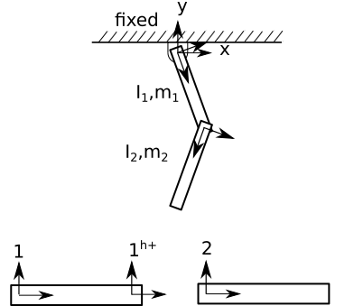
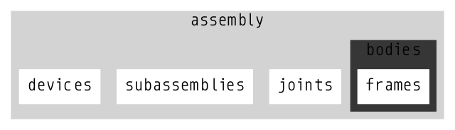
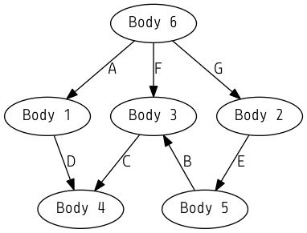

.. title:: Software Design

Software Design
===============

The numerical algorithms generated in the present work are written in the C programming language and are compiled as a static library and a command line interface. A 3D visualization tool is essential to verify the correct output of the program and therefore a graphical user interface, written in C++, OpenGL and the Qt windowing framework has been developed. This section documents some unique features of the data structures, programming methods and user interface.

Design Criteria
---------------

The following design criteria for the software, graphical user interface and datastructures have been identified:

    * The user interface should be separated from the core functionality, thereby allowing alternative front-ends to be programmed with no changes to the core code-base:

        - The bulk of code is written in C and compiled as a static library, A C application programming interface (API) is in development. The graphical user interface is written in C++ and is only used for visualization purposes.

    * File formats should be compatible with modern web technologies:

        - File formats are based on the JSON :cite:`bray2014javascript` (Javascript Object Notation) file format designation.

    * Internal and external datastructures should allow a representation of assemblies and subassemblies:

        - Bodies, joints, restraints are assigned to assemblies, which can be nested in an arbitrary, user-defined hierarchy.

    * Updating the kinematics and dynamics of a hierarchical assembly representation should require minimal logic and computational overhead:

        - A *dual graph* representation allows two simultaneous representations of mechanism topology within the computer program. A first *directed acyclic graph* (DAG) is used to access quantities by their assignment to an assembly from within the graphical user interface. A second *directed graph* representation, which is abstracted from the user in the graphical interface, is used to update the kinematics and dynamics of the mechanism.
        - A novel method, referred to as *Automata* programming, is used to process the directed graph.
        - A custom sparse, vectorized kinematics library is used throughout the program.
        - A numerical reduction method, known as Kinematic Substructuring is used to reduce floating point operations.

    * User-interface familiar to engineers:

        - The user interface is inspired by modern CAD software, an essential tool in an engineer's workflow.

Many of these design criteria are discussed in more detail below.

Data Structures
---------------

External File Format
********************

Generally, CAD software allows exporting models as a *mesh*, i.e. a representation of part geometry as a collection of points connected by patched faces. Common mesh-based file formats include STL, OBJ, PLY and others. More sophisticated data formats supported by CAD software, which in addition to allowing representation of geometry by patched faces also allow representation of complex curves and surfaces, include IGES, Parasolid and STEP. Refer to :cite:`mchenry2008overview` for an overview. These formats only account for part geometry and provide no information regarding overall system topology.

While limited support is now becoming available for exporting/exchanging topological data between commercial CAD packages, most CAD programs do not support exporting topology information to open, universal formats, such as COLLADA :cite:`collada` or X3D :cite:`x3d`. Importing and exporting topology information from CAD software is complicated by the fact that commercial CAD software uses proprietary and/or binary file formats. Another reason that export to COLLADA and X3D may not be widely supported is that these formats were originally created for general-purpose computer graphics applications, not necessarily for the specific requirements of CAD. For example, embedded in the COLLADA and X3D file formats is the notion of a *scene graph*, a root-oriented, directed graph (DG), which is used to represent the relative configuration of bodies in a scene. While the root-oriented scene graph is necessary for processing the topology, it is not a natural representation for a CAD user, who is accustomed to adding bodies to a scene and connecting them together with (directed) joints. Note that the user-specified direction, or *sense*, of the joints may not align with the root-oriented, directed graph. The latter representation is known as a Directed Acyclic Graph (DAG), and may result in multiple cyclic loops occuring in the mechanism.

Another disadvantage to the X3D and COLLADA file specification for describing multibody systems is that they are are general purpose formats with many atrributes not directly related to describing mechanism topology. Additionally, the file formats are based on the XML (eXtensible Markup Language) specification, which is more verbose and less readable than other file format specifications. For these reasons, the author has elected to design a new, simplified file format tailored to mechanisms and multibody systems.

The file format designed for the present work is based on the ASCII text based JSON (Javascript Object Notation) specification, a subset of the Javascript programming language :cite:`bray2014javascript`. JSON is a lightweight, programming language independent syntax that is faster to process than XML :cite:`nurseitov2009comparison`. JSON is a common data exchange format for web services and is a native file format representation in NoSQL databases such as CouchDB and MongoDB, and is therefore well-suited for exchange of multibody system topological data over the web.

The JSON language format has a number of advantages. JSON files are programming language independent - parsers exist in many programming languages. In this work, the Jansson C library for reading/writing JSON files :cite:`jansson` is used to facilitate loading JSON files. An advantage to the simple syntax used in the file is that it allows power users to manually generate their models using a text editor. Additionally, models can be set up using the C programming API or interactively using a graphical user interface. JSON files could also be set up in a scripted fashion  using a variety of programming languages. In the file designation, models are specified as Directed Acyclic Graphs, connecting bodies and joints together in the same manner that a model is built within CAD software. Generating a JSON file does not require the user to identify a directed graph of the mechanism.

A simple double pendulum model, as illustrated in :num:`Fig. #double-pendulum` below is used to demonstrate the JSON syntax.

.. _double-pendulum:

    Double Pendulum Model

The accompanying JSON file is shown below:

.. literalinclude:: double_pendulum.star
    :language: json

The various aspects of the JSON file are described in detail below:

The *fixed* key at the root level of the STAR JSON file represents the fixed inertial reference frame and contains only frames (i.e. coordinate systems) and lights -- i.e. no bodies or joints. If the *fixed* field is not present, a fixed inertial reference frame with only an "origin" reference frame is loaded.

Statically positioned *lights* may be specified by specifying the parent to the name of a frame within the *fixed* field. Moving lights can be specified by setting the parent frame to a frame on a moving body. If no lights are specified, a directional overhead light in the opposite direction of gravity is specified for rendering purposes.

Each entry under the *bodies* field contains a unique name and information related to mechanism topology (i.e. shape matrices :cite:`uicker2013`) and mass/inertia properties. Body geometry is specified in an external 3D file. The Assimp Open Asset Import library :cite:`assimploader` is used for loading body geometry and supports loading of a variety of mesh-based 3D file formats.

Each entry under the *frames* field contains a unique name and a shape matrix specified as a 3x3 SO3 rotation matrix and a translation vector from the body origin. As with the "fixed" inertial reference frame, it is not necessary to specify an "origin" reference frame, as with the fixed inertial reference frame, by default every body contains the "origin". Therefore, the name "origin" is a reserved keyword that cannot be used as a reference frame name at any level.

The *joints* field contains connections between frames. Each joint has a unique name, a type, an initial position and velocity, and a body-frame pair. Currently the following joint types are supported: primitive rotations (i.e. "Rx", "Ry", and "Rz"), primitive translations (i.e. "Tx", "Ty", and "Tz"), "rigid" connections used to rigidly position two bodies together, and 6DOF "float" joints, which are used to initially position a body that is not explicitly connected to the inertial reference frame. Support for compound joints such as planar, spherical, universal and gears is planned for a later version of STAR.

Springs, dampers and friction are specified under the *restraints* field. A restraint has a unique name, a type, knot points, coefficients, and either a joint name (if the restraint is aligned with a joint variable) or a body-frame pair. Torsional springs and torsional dampers must must be associated with a joint and its joint variable, but linear springs and dampers may be specified as either associated with a translational joint variable or as a body-frame pair. In the latter case, an additional field for "distance_type" may be specified. If no setting for distance type is set, the program will assume the Euclidian distance between parent and child frames should be used. Otherwise, it is possible to set the distance as aligned with the x, y or z axis of the parent frame as:

.. code-block:: javascript

    "restraint": {
      "type": "spring",
      "body_frame_pair": [
        ["body1", "1h_plus"],
        ["body2", "origin"]
      ],
      "distance_type": "Tz",
      "knot_points": [0],
      "coefficients": [[2, 0.5, 0], [0]]
    }

A spring, damper or frictional restraint may be set as a piece-wise, nonlinear function of the joint's displacement or velocity by setting knot points and arrays of coefficients. The number of coefficient arrays must be one greater than the number of knot points. For example, in the above example, the piecewise function evaluates to:

.. math::

    f(\phi) =  \begin{cases}
    2\phi^2 + 0.5\phi<0 \\
    0 & otherwise
    \end{cases}

Piecewise discontinuous functions could be used as a basis for modeling tire deflection, for example. Support for setting up more complex, user-defined force modules is possible, but beyond the scope of the current work.

The *assemblies* field contains any number of bodies and joints. In the double pendulum example, bodies "link1" and "link2" are assigned to the "double_pendulum" assembly. Although the pendulum consists of a single assembly, multiple assemblies could be inserted at the top level and any number of subassemblies can be inserted into other assemblies, nested arbitrarily deep.

Joints in one assembly can connect bodies in different assemblies/subassemblies by specifying the full path to the body in the assembly hierarchy. The ":" character is used to specify the position within an assembly hierarchy, and is therefore not a valid character to use in a descriptive name. For example,  "factory:workcell1:robot2:body1:frame1", indicates "frame1" on "body1" in the "robot2" subassembly, which is contained within the "workcell1" subassembly, which is in turn a member of the "factory" main assembly. If no path is specified, the program searches for descriptive names only within the local assembly. Note that the sense of the joint need not align with the *scene graph* of the mechanism. In the present example, the direction of the second joint is oriented in the opposite direction of the model's root-oriented graph.

Organizing models into assemblies is a concept which should be familiar to most users of CAD software. The hierarchical organization structure facilitates model reuse and rapidly building complex models from simpler models. For example, a main assembly might contain an entire factory environment, with a number of subassemblies containing robotic workcells. In turn, each workcell may each contain a number of robots or workpieces specified in their own subassemblies. Additionally, assemblies can be switched on or off to facilitate design sensitivity studies with minimal changes to the file.

Internal Data Structures
************************

When the JSON file is loaded from disk into working memory, it is imported into a linked-list datastructure. The descriptive names in the body-frame pairings are matched to set the appropriate memory pointers. The linked-list representation is used primarily for programming convenience, as it allows allocating memory for model primitives on an as-needed basis. For example, the linked-list enables a user to interactively add or remove objects from their model. Note that the linked-list representation of the model is not used for computationally intensive/demanding tasks -- aspects which are discussed later in the article.

Models are defined using the following primitives:

    * frames (coordinate systems)
    * bodies

        - *Frames* linked list

    * restraints
    * joints
    * assemblies

        - *Restraints* linked list
        - *Bodies* linked list
        - *Joints* linked list
        - *Devices* linked list
        - "Subassemblies" linked list

    Schematic of Assembly Datastructure

In addition to the data specified in the JSON file, a *Body* datastructure includes a reference frame, which may not be the origin of the body. Additionally, the body contains the geometric data loaded from the model geometry definition, such as the vertices, faces, and colors and textures.

The *Frame* datastructure contains an SE3 matrix that specifies an orientation and translation relative to a body's origin :cite:`selig2005geometric`.

In addition to the terms specified in the STAR JSON file, a *Joint* datastructure contains joint properties necessary for processing the equations of motion, such as the influence coefficient matrices :cite:`murray1994mathematical`, current joint position, velocity and accelerations.

In the C programming language, bodies and joints can be represented using structs and the connections between them as memory pointers:

.. code-block:: c

    typedef struct Frame {

      ...

    }

    typedef struct Body {

      ...

    }

    typedef struct Joint {

      ...

      Body* parentBody;
      Frame* parentFrame;

      Body* childBody;
      Frame* childFrame;
    }

Dual Graphs
------------

Directed Acyclic Graphs vs. Directed Graphs
*******************************************

An example is provided to explain the difference between Directed Acyclic Graphs (i.e. the body-joint-body representation familiar to CAD users) and Directed Graphs. Consider the hydraulic clamp mechanismm in Fig 2. below.

.. figure:: hydraulic_clamp.png
    :width: 300px
    :align: center

    .. only:: html
        Hydraulic Clamp Mechanism, from :cite:`uicker2013`

    .. only:: latex
        Hydraulic Clamp Mechanism, from \cite{uicker2013}

Its directed acyclic graph is shown in Fig. 3.

    Directed Acyclic Graph (DAG)

As stated above, the DAG representation of the mechanism is convenient for user representation of topology, but a root-oriented directed graph is necessary to update the system topology. In the present example, there are multiple paths in the DAG to update the position and orientation of bodies 3 and 4.

To resolve this ambiguity, the root-oriented DG, i.e. *spanning tree*, of the mechanism, is identified. The spanning tree is the subset of graph edges that touches every node in the DAG representation exactly once. This process requires identifying the set of arcs and chords of the directed graph as shown in Fig. 4. Automatic methods for obtaining the set of arcs and chords in an acyclic graph representation are discussed later in this document (also refer to :cite:`wehage2015generalized,uicker2013`).

In this example, the arcs of the directed graph are shown in black and the chords are shown in blue. Note that the sense of joint B (shown in red) has also been flipped to align with the spanning tree. If the chords of the graph are removed, each body will have a unique parent body and associated joint.

.. figure:: directed_acyclic_graph2.png
    :width: 300px
    :align: center

    Directed Acyclic Graph with Arcs and Chords identified

The instructions to update the topology of a multibody system are coded using function pointers. Function pointers are a powerful tool in the C programming language which allow calling specific functions at program run-time based on definitions supplied in a user's model definition. For example, if a user has specified a joint as a revolute joint about the X-axis, a function pointer for a vectorized, sparse matrix multiplication for a rotation about the x axis is called. A function pointer *could* be stored in each body and joints as:

.. code-block:: c

    typedef struct Body {

      ...

      void* bodyFunctionPointer(Body*); // update shape matrices

      int childCount;
      Joint** childJoints;
    }

    typedef struct Joint {

      ...

      void* jointFunctionPointer(Joint*); // updates influence coefficient
                                          // matrices, accelerations,
                                          // velocities, relative values across
                                          // joints, etc.
      Body* parentBody;
      Frame* parentFrame;

      Body* childBody;
      Frame* childFrame;
    }

Once the spanning tree of the directed graph has been identified, one way to process the system topology with the arcs removed is through recursion:

.. code-block:: c

    void RecursiveTreeTraversal(Body* body) {

      body->bodyFunctionPointer(body); // update shape matrices

      // process children
      for(int i = 0; i < body->childCount; i++) {
        body->childJoints[i]->jointFunctionPointer(body->childJoint[i]);
        RecursiveTreeTraversal(body->childJoint[i]->childBody);
      }
    }

    // then call the recursive function as
    Body* fixed;
    RecursiveTreeTraversal(fixed);

Note, however, that there are a number of disadvantages with this approach:

    * Chords D and E are not updated. Additional logic is required to process properties related to chord joints
    * This approach involves many pointer dereferences that the compiler will not be able to optimize away as there is no way for the compiler to know the body-joint-body sequence ahead of time
    * Recursion is memory inefficient and slow
    * Traversing a linked list datastructure in fragmented memory is cache-inefficient.
    * By removing joints D and E from the graph, the user's original acyclic representation is lost

Dual Graph Representation
*************************

To address these disadvantates, a different approach to process and update the system's topology is taken. The user's original directed acyclic graph shown in Fig. 2 is maintained, and a second *dual* directed graph is created. Each time the user adds or removes a body or joint, memory for the second directed graph is freed and a new graph is generated automatically. Instead of removing joints from the user's original DAG representation, additional massless *virtual* bodies (shown in octagons) are added and constraints (shown as a dashed blue lines) are imposed as shown in Fig. 5 below.

.. figure:: directed_graph.png
    :width: 600px
    :align: center

    Dual Directed Graph representation

An important aspect in this process is that memory is allocated for quantities required to update the mechanism's topology based on the total number of *active* bodies, joints and frames in the system. Data are then copied by value from their position in the directed acyclic graph representation to the *dual* directed graph representation and the memory pointers in each of the bodies and joints are updated to point to the new locations. Quantities required to process the kinematics and dynamics of the system are now stored in contiguous, closely-packed memory in a *struct of arrays* (SOAs) datastructure, which improves data locality and serves to minimize cache misses :cite:`bryant2003computer`. Note that care has been taken using a memory profiler to ensure that there are no memory leaks when the second dual directed graph representation is created or destroyed.

If STAR detects that the sense of the joint should be flipped in the directed graph representation to align with the spanning tree (as in the above example), the inverse transformation is set in the appropriate position in the function pointer array automatically, so as to maintain the user's originally defined sense.

The *dual* graph representation is completely transparent to the user. The user can access body and joint parameters through their orginal linked-list Directed Acyclic Graph representation within each assembly using the C-API or through the graphical user interface. The assemblies serve to organize the pointers to bodies, joints, frames, devices and other objects, but are not represented in the second Directed Graph representation. Another advantage to the dual graph representation is that data exists in only one location. As the kinematics and dynamics of the mechanism are updated, there is no need to copy data by value to a second datastructure.

As both the DAG and DG are simultaneously present in computer memory, multiple output formats are possible. For example, a user could make changes to the DAG in the GUI and save the updated results back to disk in the JSON file format described above. Alternatively, the second, DG representation of the mechanism could be used to generate a file format that utilitizes the DG representation, such as a  COLLADA or X3D -- although writing an export module is beyond the scope of the present work.

Automata Programming
--------------------

One technique to avoid function recursion is to arrange bodies and joints in monotonically increasing level order within computer memory, a technique originally described in :cite:`serban1997topology`. In a multiloop system, once the virtual bodies are added as described above, the number of bodies and joints are equal and traversing the topology is simplified. Using the function pointer method described above, the joint and body function pointers can be called as:

.. code-block:: c

    int n;
    Body** bodyPointers = malloc(n * sizeof(Body *));
    Joint** joints = malloc(n * sizeof(Joint *));

    for(int i = 0; i < n; i++) {
      joints[i]->functionPointer(joints[i]); // update relative properties
                                             // parent joint
      bodies[i]->functionPointer(body[i]);   // update shape matrices on body
    }

The above technique obviates the need for recursion, but the logic for processing the system topology can be even further simplified. For brevity, the exact details of each body function pointer are not shown, but note that the function requires updating one or more shape matrices across a body, which requires a number of pointer dereferences and secondary loop constructs to book-keep the operations.

The approach taken in the present work is to generate a first function pointer array for updating both joints and bodies and a second data pointer array, which indicates the memory addresses where each function pointer should read and write the data to:

.. code-block:: c

    int n;
    void* functionPointer(double** dataPointer);
    double*** dataPointer;

This method significantly reduces the logic required to traverse the spanning tree, as illustrated in the below code:

.. code-block:: c

    for(int i = 0; i < n; i++) {
      functionPointer[i](dataPointer[i]);
    }

This dynamic building of a program from an external model definition is referred to as *Automata based programming* :cite:`booth1967sequential`. The concept is used by other model based programming languages such as the Unified Modeling Language (UML) :cite:`rumbaugh2004unified`, but to the author's knowledge, the technique has not been applied to the automated simplification of graph traversal of a multibody system, or other applications related to dynamics and trajectory analysis. The technique has been successfully programmed to update the topology, but has not been benchmarked against standard methods of graph traversal, such as the recursive method described above. If the automata-based method offers performance advantages, the approach will be used throughout the code.

Graphical User Interface
------------------------

An example mechanism is shown in a screen shot below. The assembly hierarchy, displayed at the left of the viewport, is generated using recursion from the linked-list assembly hierarchy representation described above. The multibody system shown in the viewport is updated using the DG representation.

.. figure:: screenshot.png
    :align: center

    Screenshot of user interface showing a hydraulic excavator
