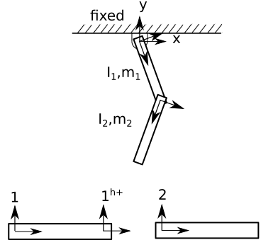

.. title:: File Format

File Format
===========

The file format designed for the present work is based on the ASCII text based JSON (Javascript Object Notation) specification, a subset of the Javascript programming language :cite:`bray2014javascript`. JSON is a lightweight, programming language independent syntax that is faster to process than XML :cite:`nurseitov2009comparison`. JSON is a common data exchange format for web services and is a native file format representation in NoSQL databases such as CouchDB and MongoDB, and is therefore well-suited for exchange of multibody system topological data over the web.

The JSON language format has a number of advantages. JSON files are programming language independent - parsers exist in many programming languages. In this work, the Jansson C library for reading/writing JSON files :cite:`jansson` is used to facilitate loading JSON files. An advantage to the simple syntax used in the file is that it allows power users to manually generate their models using a text editor. Additionally, models can be set up using the C programming API or interactively using a graphical user interface. JSON files could also be set up in a scripted fashion  using a variety of programming languages. In the file designation, models are specified as Directed Acyclic Graphs, connecting bodies and joints together in the same manner that a model is built within CAD software. Generating a JSON file does not require the user to identify a directed graph of the mechanism.

A simple double pendulum model, as illustrated in :num:`Fig. #double-pendulum` below is used to demonstrate the JSON syntax.

.. _double-pendulum:

    Double Pendulum Model

The accompanying JSON file is shown below:

.. literalinclude:: ../../../src/models/pendulum/double_pendulum.json
    :language: json

The various aspects of the JSON file are described in detail below:

The *fixed* key at the root level of the STAR JSON file represents the fixed inertial reference frame and contains only frames (i.e. coordinate systems) and lights -- i.e. no bodies or joints. If the *fixed* field is not present, a fixed inertial reference frame with only an "origin" reference frame is loaded.

Statically positioned *lights* may be specified by specifying the parent to the name of a frame within the *fixed* field. Moving lights can be specified by setting the parent frame to a frame on a moving body. If no lights are specified, a directional overhead light in the opposite direction of gravity is specified for rendering purposes.

Each entry under the *bodies* field contains a unique name and information related to mechanism topology (i.e. shape matrices :cite:`uicker2013`) and mass/inertia properties. Body geometry is specified in an external 3D file. The Assimp Open Asset Import library :cite:`assimploader` is used for loading body geometry and supports loading of a variety of mesh-based 3D file formats.

Each entry under the *frames* field contains a unique name and a shape matrix specified as a 3x3 SO3 rotation matrix and a translation vector from the body origin. As with the "fixed" inertial reference frame, it is not necessary to specify an "origin" reference frame, as with the fixed inertial reference frame, by default every body contains the "origin". Therefore, the name "origin" is a reserved keyword that cannot be used as a reference frame name at any level.

The *joints* field contains connections between frames. Each joint has a unique name, a type, an initial position and velocity, and a body-frame pair. Currently the following joint types are supported: primitive rotations (i.e. "Rx", "Ry", and "Rz"), primitive translations (i.e. "Tx", "Ty", and "Tz"), "rigid" connections used to rigidly position two bodies together, and 6DOF "float" joints, which are used to initially position a body that is not explicitly connected to the inertial reference frame. Support for compound joints such as planar, spherical, universal and gears is planned for a later version of STAR.

Springs, dampers and friction are specified under the *restraints* field. A restraint has a unique name, a type, knot points, coefficients, and either a joint name (if the restraint is aligned with a joint variable) or a body-frame pair. Torsional springs and torsional dampers must must be associated with a joint and its joint variable, but linear springs and dampers may be specified as either associated with a translational joint variable or as a body-frame pair. In the latter case, an additional field for "distance_type" may be specified. If no setting for distance type is set, the program will assume the Euclidian distance between parent and child frames should be used. Otherwise, it is possible to set the distance as aligned with the x, y or z axis of the parent frame as:

.. code-block:: javascript

    "restraint": {
      "type": "spring",
      "body_frame_pair": [
        ["body1", "1h_plus"],
        ["body2", "origin"]
      ],
      "distance_type": "Tz",
      "knot_points": [0],
      "coefficients": [[2, 0.5, 0], [0]]
    }

A spring, damper or frictional restraint may be set as a piece-wise, nonlinear function of the joint's displacement or velocity by setting knot points and arrays of coefficients. The number of coefficient arrays must be one greater than the number of knot points. For example, in the above example, the piecewise function evaluates to:

.. math::

    f(\phi) =  \begin{cases}
    2\phi^2 + 0.5\phi<0 \\
    0 & otherwise
    \end{cases}

Piecewise discontinuous functions could be used as a basis for modeling tire deflection, for example. Support for setting up more complex, user-defined force modules is possible, but beyond the scope of the current work.

The *assemblies* field contains any number of bodies and joints. In the double pendulum example, bodies "link1" and "link2" are assigned to the "double_pendulum" assembly. Although the pendulum consists of a single assembly, multiple assemblies could be inserted at the top level and any number of subassemblies can be inserted into other assemblies, nested arbitrarily deep.

Joints in one assembly can connect bodies in different assemblies/subassemblies by specifying the full path to the body in the assembly hierarchy. The ":" character is used to specify the position within an assembly hierarchy, and is therefore not a valid character to use in a descriptive name. For example,  "factory:workcell1:robot2:body1:frame1", indicates "frame1" on "body1" in the "robot2" subassembly, which is contained within the "workcell1" subassembly, which is in turn a member of the "factory" main assembly. If no path is specified, the program searches for descriptive names only within the local assembly. Note that the sense of the joint need not align with the *scene graph* of the mechanism. In the present example, the direction of the second joint is oriented in the opposite direction of the model's root-oriented graph.

Organizing models into assemblies is a concept which should be familiar to most users of CAD software. The hierarchical organization structure facilitates model reuse and rapidly building complex models from simpler models. For example, a main assembly might contain an entire factory environment, with a number of subassemblies containing robotic workcells. In turn, each workcell may each contain a number of robots or workpieces specified in their own subassemblies. Additionally, assemblies can be switched on or off to facilitate design sensitivity studies with minimal changes to the file.
