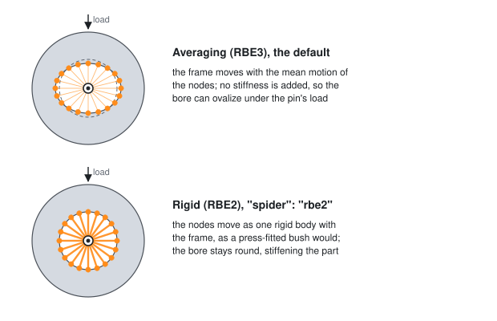
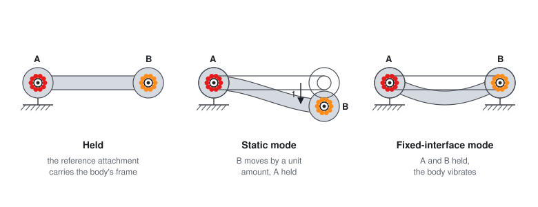
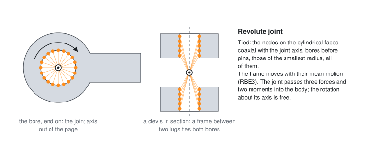
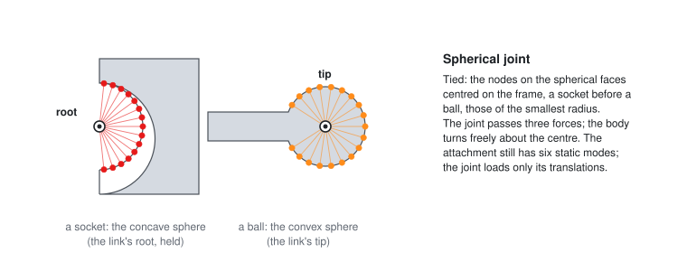
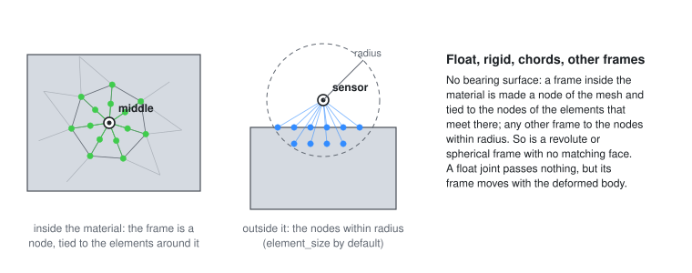
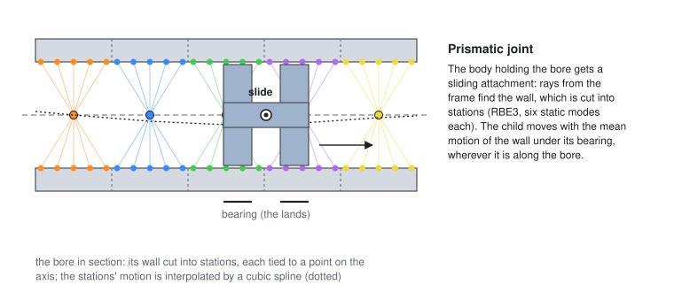

.. _flexible-bodies:

Flexible Bodies
===============

A flexible body bends, stretches and twists as the model runs, so the
loads and motion of a machine include the elasticity of its parts: a
connecting rod whipped by its crank, a boom under its load, a long shaft.
This page explains what *Shift* does with such a body: the finite elements
it is made of, how its mesh is made from a STEP or mesh file, how its
joints are tied to the mesh, and how to look at all of this in the viewer.
The keys of each body type are listed in :ref:`the model file reference
<model-file-flexible-bodies>`.

.. figure:: ../images/flex/flex_attachments.jpg
   :width: 100%
   :alt: two flexible bodies drawn by their finite element meshes, with the
         nodes tied to their joints

   ``examples/flex/attachments.json``: a link with a spherical socket at
   its root, a ball at its tip and a float joint at its middle, and a tube
   with a plunger sliding in its bore. Each is drawn by the surface of its
   finite element mesh, with the edges of its elements, and the nodes tied
   to its joints as points, each attachment in its own color with its
   spider: red the link's socket, which holds it (its reference), blue
   the float joint's frame at its middle, orange its ball; along the
   tube's bore, the stations of the sliding attachment, each in its own
   color (the tube's mount, red, is under it: see `Float and rigid joints,
   chords, and other frames`_).

Body types
----------

``"type": "modal"``
   The body's motion is that of a *reference frame* that follows it
   through large rotations and translations, plus a small deformation in
   that frame (the floating frame of reference). The deformation is a sum
   of a few *shapes*, each times an elastic coordinate. The shapes are the
   static modes of its attachments and the lowest vibration modes of the
   body with its attachments held (Craig–Bampton), computed by *Shift*
   from a finite element mesh. This is the type to use for most parts.

``"type": "nodal"``
   The same floating frame, with the shapes of a Guyan reduction: the
   static modes of the attachments and the three translations of each
   chosen point (``retained_points``). Each elastic coordinate is then
   the displacement of a point of the part, which is easy to read, but
   without vibration modes it misses the dynamics of the parts between the
   points.

``"type": "ancf"`` (planned)
   Bodies that deform by large amounts (cables, hoses, belts) by the
   absolute nodal coordinate formulation, with beam and shell elements.
   Not yet available.

Both ``modal`` and ``nodal`` bodies work with every solver (``rnca``,
``aba`` and ``dca``), in trees and in closed loops, and with any joint
before or after them: revolute, prismatic, spherical, float or rigid.

The finite elements
-------------------

*Shift* makes one kind of finite element model, a solid one, and reduces
it to the few elastic coordinates of the body.

.. list-table::
   :header-rows: 1
   :widths: 25 75

   * - Element
     - What it is and where it is used
   * - 10-node tetrahedron
     - The solid element of every mesh: a tetrahedron with a node at each
       corner and at the middle of each edge, so its displacement varies
       quadratically and its edges can curve to follow the part's surface.
       Its stiffness is integrated by a 4-point rule from the body's
       ``youngs_modulus`` and ``poisson_ratio`` (isotropic, linear
       elastic). Its mass is lumped at its nodes from ``density``:
       :math:`\rho V/36` at each corner and :math:`4\rho V/27` at each
       mid-side node (Hinton, Rock and Zienkiewicz 1976; adding up the
       rows of the consistent mass matrix would give the corners negative
       mass).
   * - 6-node triangle
     - The faces of the tetrahedra on the boundary of the solid. They are
       not elements of their own, but they carry the drawing of the
       deformed surface, the stress on it, and the search for the faces a
       joint bears on.
   * - RBE3 attachment (averaging)
     - Ties a frame to a set of nodes so that the frame moves with their
       mean motion: its translation is the mean of their translations and
       its rotation the one that best fits their motion about their
       centre. It adds no stiffness, so a bore tied this way can still
       ovalize under load. This is the default.
   * - RBE2 attachment (rigid)
     - Ties a set of nodes rigidly to a frame: they move as one rigid body
       with it. This stiffens the part where it is tied, as a press-fitted
       bush would; ``"spider": "rbe2"`` chooses it.
   * - Sliding attachment
     - The wall of a bore along which a ``prismatic`` joint's child slides,
       cut into lengths along the axis, each tied by an RBE3 attachment to a
       station on the axis. See `Prismatic joints`_.

   The two ways a frame is tied to its nodes. In the drawings on this page
   the frame is the black target and its *spider*, the lines to the nodes it
   ties, is drawn in the attachment's color.

The mesh has thousands of nodes; the body has a few tens of elastic
coordinates. The reduction keeps the motion of the attachments exactly,
and the rest of the body's motion through its shapes. The displacements of
the nodes are

.. math::

   \underline{u} = \sum_{a} \Upsilon_a \underline{x}_a
                 + \sum_{k} \underline{\upsilon}_k \, \eta_k

where :math:`\underline{x}_a` holds the six displacements of attachment
:math:`a` (relative to the reference frame), :math:`\Upsilon_a` its six
static modes (the deflection of the body when that attachment alone moves
by a unit amount and the others are held), and :math:`\eta_k` the
coordinate of fixed-interface vibration mode :math:`\underline{\upsilon}_k`
(``modal``) or of a retained point's displacement (``nodal``). The
elastic coordinates of the body are the :math:`\underline{x}_a` and the
:math:`\eta_k`, the static modes first.

Boundary conditions of the reduction
------------------------------------

   A link with attachments A (the reference, red) and B. A is held in every
   shape. A static mode of B is the link's deflection when B alone moves
   by a unit amount; a fixed-interface mode is a vibration with A and B
   both held.

The body is analysed free, not fixed to the ground, but with its
attachments as its boundary:

- the attachment of the frame of the body's *parent joint* (the joint that
  places the body in the tree) is held. It carries the reference frame, so
  every shape is a deformation relative to it, and the body's rigid
  motion comes from its joints;
- every other attachment gives six static modes: the body's deflection
  when that attachment alone translates or rotates by a unit amount, the
  reference and the other attachments held;
- the vibration modes of a ``modal`` body are those of the body with every
  attachment held (fixed-interface modes), the lowest ``mode_count`` of
  them (10 by default), those below ``maximum_frequency``, or those chosen
  in ``modes_kept``.

A frame that no joint, chord or listed attachment uses is not tied, and
moves with the reference frame as if the body were rigid there.

Making the mesh
---------------

``fe_geometry`` names one of the body's geometries, which *Shift* fills
with tetrahedra when the model loads.

From a STEP file
   1. *Shift* reads the solid with its own STEP reader, keeping the exact
      surfaces: planes, cylinders, cones, spheres, tori and NURBS.
   2. It triangulates the closed surface of the solid. Each edge of the
      solid is divided once, into segments no longer than
      ``element_size``, within ``element_size``/20 of the exact curve and
      turning by at most 0.5 rad, and both faces that meet at the edge use
      the same points, so the surface has no cracks. Each face is then
      filled with triangles in its own surface coordinates and refined
      until every triangle is shorter than ``element_size``, within
      ``element_size``/20 of the exact surface, and not too thin. Small
      features (fillets, small holes) get smaller triangles, down to
      ``minimum_element_size``.
   3. Netgen fills the closed surface with tetrahedra, grading their size
      from the surface inwards. Frames inside the material, and
      ``retained_points``, are made nodes exactly where they lie.
   4. A node is added at the middle of each edge, and each mid-side node
      on the boundary is moved onto the exact curve or surface, so the
      elements follow the curve of a bore rather than its chords. A move
      that would distort an element too much (its Jacobian falling to 0.2
      of the straight element's) is undone.

From a mesh file (OBJ, STL, ...)
   The triangles must close a solid: every edge shared by two triangles.
   The split corners of the file are joined, the surface is remade by
   Netgen's surface mesher at about ``element_size`` (finer where it
   curves; edges where the surface turns by more than 0.5 rad are kept
   sharp), and then filled as above. A mesh has no exact surfaces, so the
   mid-side nodes stay straight, and the faces a joint bears on are found
   from the triangles (see below).

Then the stiffness and mass matrices are assembled, and the body is
reduced (Eigen's sparse Cholesky factorization for the static modes,
Spectra for the vibration modes). The log reports the result, for
example::

  Flexible body 'link': 4358 tetrahedra, 8175 nodes, volume 4.55055e-05,
  mass 0.357218; 12 static and 4 fixed-interface modes of 4 computed;
  'socket' rbe3 to 402 nodes; 'ball' rbe3 to 721 nodes; 'middle' rbe3 to
  265 nodes; frequencies (Hz) 6835 6905.36 8651.47 8742.59

The mass, centre of mass and inertia of the body come from the mesh and
the density, so ``inertia`` and ``center_of_mass`` are not used.

Mesh size
---------

Two keys of the body set the mesh:

``element_size`` (required)
   The longest element edge, in the model's units of length. It also sets
   how closely the surface follows the exact geometry (within
   ``element_size``/20). Smaller is more accurate and slower: the number of
   elements grows as the cube of 1/``element_size``. Two or three elements
   through the thinnest wall that bends is a good start.

``minimum_element_size`` (optional)
   The shortest edge that refinement at small features may make; by
   default ``element_size``/20.

.. code:: javascript

   {
     "name": "link",
     "type": "modal",
     "density": 7850, "youngs_modulus": 2.1e11, "poisson_ratio": 0.3,
     "fe_geometry": "link",
     "element_size": 0.004,
     "minimum_element_size": 0.001,
     "mode_count": 4,
     "geometry": [{"name": "link", "type": "mesh", "filename": ["link.obj"]}],
     "frames": [{"name": "socket"},
                {"name": "ball", "T": [0.2, 0.0, 0.0]}]
   }

The other tolerances (the deviation from the exact surface, the turn of a
curve per segment, the feature angle of a mesh file) follow from these and
are not keys of their own.

Regenerating the mesh
---------------------

The mesh and its reduction are kept in a file beside the model
(``<model>.<assembly>__<body>.fe.h5``, or ``fe_cache``), labelled by a
fingerprint of everything they depend on: the geometry file, its placement
and scale, the material, ``element_size`` and ``minimum_element_size``,
the attachments and the retained points. When the model is opened, the
file is used if the fingerprint matches, and the body is meshed and
analysed again if it does not.

In the viewer, the panel of a flexible body built from a mesh shows its
*Element size* and *Minimum size* (empty for the default,
``element_size``/20). Its *Modes...* button opens the mode window, which
lists the static modes and every vibration mode computed, with its
frequency, and draws the one selected on the body; the vibration modes of
a ``modal`` body can be checked there to choose those kept. The panel's
*Apply* button, enabled once something differs from the model, writes
every change to the body at once (``element_size``,
``minimum_element_size``, and the modes checked as ``modes_kept``) and
loads the model again: a new mesh size meshes and analyses the body again,
while other modes among those already computed are read from the
``.fe.h5`` file. The changes are in the model the viewer holds, marked
"(edited)" in the title; File > Save model as... writes them to a file.
The same keys can also be edited in the parameters panel.

Outside the viewer, change ``element_size`` (or anything else above) in
the model file and run it again. Deleting the ``.fe.h5`` file forces a new
analysis with the same settings.

Meshing a large part can take a while; the viewer loads the model in the
background, showing each stage (solid, meshing, assembly, modes), and its
Cancel button stops the load.

Seeing the mesh and the attachments
-----------------------------------

Select a flexible body in the viewer to open its panel:

- *Draw the mesh's surface*: the surface of the finite element mesh in
  place of the CAD solid;
- *Draw the elements' edges*: the edges of the elements over the surface,
  through their mid-side nodes;
- *Draw the constrained nodes*: each attachment's frame and the nodes it
  ties, as points in the attachment's color (the reference attachment, which
  is held, in red), joined by its spider, drawn over the body;
- *Attachments*: a list of the attachments in those colors: the frame,
  the joint or chord that uses it, RBE3 or RBE2, the number of nodes, and
  whether it is the held reference or gives six static modes (a sliding
  attachment on one line, with its stations);
- *Draw the stresses*: the stress on the surface drawn, the CAD solid's
  or the mesh's (the quantity, color map and range of *Edit > Settings >
  Flexible Bodies*);
- *Modes...*: the mode window;
- *Element size*, *Minimum size* and *Apply*: see `Regenerating the
  mesh`_.

*Edit > Settings > Flexible Bodies* does each of these for every flexible
body when a model opens, and its *Deformation scale* magnifies the
deformation. To render an image
from the command line::

  build/shift/main/shift examples/flex/attachments.json --image link.png \
    --time 0 --mesh-surface --mesh-edges --constrained-nodes --no-floor

The edges and the nodes are drawn in raster mode only (not when ray
tracing). The images on this page were made this way.

How the nodes of each joint are chosen
--------------------------------------

Each frame of the body that a joint or chord uses is tied to the mesh by
an attachment; so is each frame listed in ``attachments``. The nodes are
chosen by the type of the joint.

Revolute joints
~~~~~~~~~~~~~~~

   A revolute joint's frame is tied to the bore round its axis; between
   the lugs of a clevis, to both bores.

.. figure:: ../images/flex/flex_attach_revolute.jpg
   :width: 60%
   :alt: the nodes on the bore of a connecting rod

   The big end of ``examples/flex/slider_crank_flexible_rod.json``: the
   nodes on the bore, tied to the crank pin's revolute joint; red, as the
   joint that places the rod holds it.

The frame is tied to the cylindrical faces whose axis is the joint's axis
through the frame (within 2 % of the radius). Bores (the material outside
the cylinder) are preferred to pins (the material inside); among them, the
faces of the smallest radius are taken, all of them, so a frame between
the two lugs of a clevis takes both bores.

Spherical joints
~~~~~~~~~~~~~~~~

   The link of ``examples/flex/attachments.json``: its root a socket, held
   as the reference (red), its tip a ball.

.. list-table::
   :widths: 50 50

   * - .. figure:: ../images/flex/flex_attach_socket.jpg
          :width: 100%
          :alt: the nodes in a spherical socket

          A socket: the concave spherical face round the frame, red as
          the link's reference attachment, held.
     - .. figure:: ../images/flex/flex_attach_ball.jpg
          :width: 100%
          :alt: the nodes on a ball

          A ball: the convex spherical face round the frame, with six
          static modes.

The frame is tied to the spherical faces centred on it (within 2 % of
the radius), concave or convex: a socket (the material outside the sphere)
is preferred to a ball, and among them the faces of the smallest radius
are taken. A ball and a socket on the same body at the same centre would
take the socket.

Float and rigid joints, chords, and other frames
~~~~~~~~~~~~~~~~~~~~~~~~~~~~~~~~~~~~~~~~~~~~~~~~

   With no face to bear on, a frame inside the material is tied to the
   elements round it, and one outside to the nodes within ``radius``.

.. figure:: ../images/flex/flex_attach_interior.jpg
   :width: 60%
   :alt: the nodes round a frame inside the link's shank

   The frame at the middle of the link, inside its shank (blue): its node
   and the nodes of the elements round it.

.. figure:: ../images/flex/flex_attach_radius.jpg
   :width: 60%
   :alt: the nodes within a radius of the tube's mount, on its underside

   The tube seen from below: its rigid joint to the ground at frame
   ``base``, on the outer surface, listed in ``attachments`` with a
   ``radius`` of 5 mm (red, the tube's reference, held), clear of the
   bore's first station (orange).

A float or rigid joint, a chord, and a revolute or spherical joint for
which no such face is found have no surface to bear on. A frame inside
the material is made a node of the mesh, and is tied to that node and the
nodes of the elements that meet there. A frame outside the material (or
one given a ``radius``) is tied to the nodes within ``radius`` of it,
``element_size`` by default.

A float joint transmits no force, but its frame is tied all the same: the
frame of the parent joint must sit on the deformed body, and a frame from
which a float joint hangs moves with the deformation so that the child's
coordinates are measured from the deformed body. A float joint from a
node costs the body six static modes that its joint never loads.

Prismatic joints
~~~~~~~~~~~~~~~~

   A sliding attachment: each station (its own color) ties a length of the
   bore's wall to a point on the axis; the plunger moves with the wall
   under its two lands.

.. figure:: ../images/flex/flex_attach_bore.jpg
   :width: 60%
   :alt: the nodes on the wall of the tube's bore

   The wall of the tube's bore, tied to the plunger's prismatic joint: a
   station at its mouth (orange), the next (blue) beyond.

A body that holds the parent side of a ``prismatic`` joint (a frame on
the axis of a bore, whose child slides along it) gets a *sliding
attachment*. Sixteen rays cast from the frame at right angles to the axis
find the bore's wall; the wall is cut along the axis into equal lengths,
each tied (RBE3) to a station on the axis at its middle. As the child
slides, it moves with the mean motion of the wall under its *bearing*, the
stations' motion interpolated along the axis by a cubic spline:

- the bearing is ``bearing_length`` centred on the child's frame if
  given, else the part of the child's surface that lies on the bore
  (within 5 % of its radius: the two lands of a piston give two parts),
  else the bore's diameter;
- the number of stations is the fewest (two or more, each at least
  ``element_size`` long) whose compliance at the child is within 1 % of
  the full finite element model's, or beyond which more stations no
  longer lower that error by a tenth. The log reports the stations and the
  error.

The child must stay in the bore: a closed bore round the axis is found,
not an open guide (a slot or a rail), and a joint has one sliding
attachment.

Overrides
~~~~~~~~~

Each entry of the body's ``attachments`` changes the choice for one
frame:

.. code:: javascript

   "attachments": [
     {"frame": "small_end", "spider": "rbe2"},
     {"frame": "base", "radius": 0.0025},
     {"frame": "pin", "faces": [12, 13]},
     {"frame": "sensor"}
   ]

``spider`` chooses RBE2 or RBE3; ``radius`` ties the nodes within that
distance of the frame; ``faces`` names the faces of the STEP solid by
their index (not for a mesh file); and a frame that only a force module
or sensor uses is tied only if it is listed, so that the load or reading
follows the deformation.

Two attachments may not share nodes: the log names the two frames, and a
smaller ``radius`` or explicit ``faces`` separates them.
