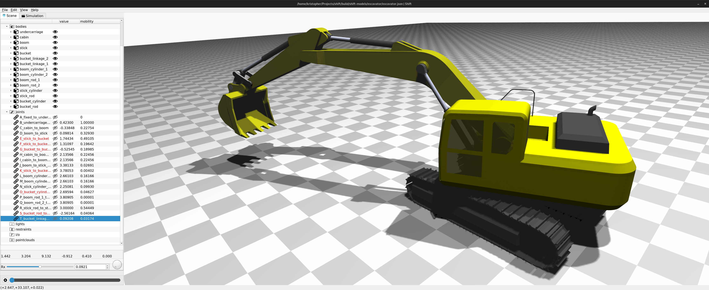

.. Shift documentation master file

*Shift*
====================================================
A Dynamics Engine and Visualization Tool for Automation and Robotics

overview
--------
.. toctree::
   :maxdepth: 2

   about
   installation
   file_format/file_format
   contributing/contributing
   page_index.rst
   zreferences

.. developer reference
.. -------------------
..
.. .. toctree::
..    :maxdepth: 2
..
..    notation/notation
..    kinematics/kinematics
..    topology/topology
..    dynamics/dynamics
..    zreferences

.. api reference
.. -------------

.. .. toctree::

..    doxyrest/global.rst

indices and tables
------------------

* :ref:`genindex`
