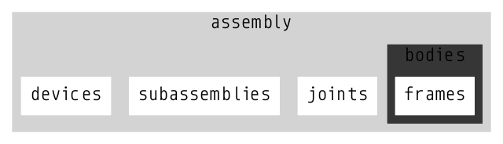
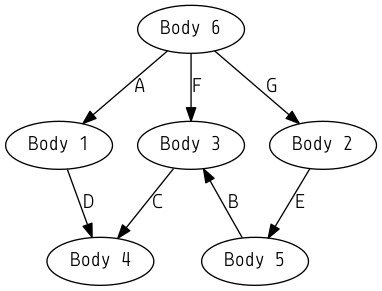

.. title:: Software Design

Software Design
===============

.. include:: notation/notation.rst

.. include:: preliminaries/preliminaries.rst

.. include:: generalized_coordinate_partitioning/generalized_coordinate_partitioning.rst

.. include:: kinematic_substructuring/kinematic_substructuring.rst

.. include:: solving_equations/solving_equations.rst

Internal Data Structures
------------------------

When the JSON file is loaded from disk into working memory, it is imported into a linked-list datastructure. The descriptive names in the body-frame pairings are matched to set the appropriate memory pointers. The linked-list representation is used primarily for programming convenience, as it allows allocating memory for model primitives on an as-needed basis. For example, the linked-list enables a user to interactively add or remove objects from their model. Note that the linked-list representation of the model is not used for computationally intensive/demanding tasks -- aspects which are discussed later in the article.

Models are defined using the following primitives:

    * frames (coordinate systems)
    * bodies

        - *Frames* linked list

    * restraints
    * joints
    * assemblies

        - *Restraints* linked list
        - *Bodies* linked list
        - *Joints* linked list
        - *Devices* linked list
        - "Subassemblies" linked list

    Schematic of Assembly Datastructure

In addition to the data specified in the JSON file, a *Body* datastructure includes a reference frame, which may not be the origin of the body. Additionally, the body contains the geometric data loaded from the model geometry definition, such as the vertices, faces, colors and textures.

The *Frame* datastructure contains an SE3 matrix that specifies an orientation and translation relative to a body's origin :cite:`selig2005geometric`.

In addition to the terms specified in the STAR JSON file, a *Joint* datastructure contains joint properties necessary for processing the equations of motion, such as the influence coefficient matrices :cite:`murray1994mathematical`, current joint position, velocity and accelerations.

In the C programming language, bodies and joints can be represented using structs and the connections between them as memory pointers:

.. code-block:: c

    typedef struct Frame {

      ...

    }

    typedef struct Body {

      ...

    }

    typedef struct Joint {

      ...

      Body* parentBody;
      Frame* parentFrame;

      Body* childBody;
      Frame* childFrame;
    }

Dual Graphs
------------

Directed Cyclic Graphs vs. Directed Graphs
*******************************************

An example is provided to explain the difference between Directed Acyclic Graphs (i.e. the body-joint-body representation familiar to CAD users) and Directed Graphs. Consider the hydraulic clamp mechanismm in Fig 2. below.

.. figure:: figures/hydraulic_clamp.png
    :width: 300px
    :align: center

    .. only:: html
        Hydraulic Clamp Mechanism, from :cite:`uicker2013`

    .. only:: latex
        Hydraulic Clamp Mechanism, from \cite{uicker2013}

Its directed acyclic graph is shown in Fig. 3.

    Directed Acyclic Graph (DAG)

As stated above, the DAG representation of the mechanism is convenient for user representation of topology, but a root-oriented directed graph is necessary to update the system topology. In the present example, there are multiple paths in the DAG to update the position and orientation of bodies 3 and 4.

To resolve this ambiguity, the root-oriented DG, i.e. *spanning tree*, of the mechanism, is identified. The spanning tree is the subset of graph edges that touches every node in the DAG representation exactly once. This process requires identifying the set of arcs and chords of the directed graph as shown in Fig. 4. Automatic methods for obtaining the set of arcs and chords in an acyclic graph representation are discussed later in this document (also refer to :cite:`wehage2015generalized,uicker2013`).

In this example, the arcs of the directed graph are shown in black and the chords are shown in blue. Note that the sense of joint B (shown in red) has also been flipped to align with the spanning tree. If the chords of the graph are removed, each body will have a unique parent body and associated joint.

.. figure:: figures/directed_acyclic_graph2.png
    :width: 300px
    :align: center

    Directed Acyclic Graph with Arcs and Chords identified

The instructions to update the topology of a multibody system are coded using function pointers. Function pointers are a powerful tool in the C programming language which allow calling specific functions at program run-time based on definitions supplied in a user's model definition. For example, if a user has specified a joint as a revolute joint about the X-axis, a function pointer for a vectorized, sparse matrix multiplication for a rotation about the x axis is called. A function pointer *could* be stored in each body and joints as:

.. code-block:: c

    typedef struct Body {

      ...

      void* bodyFunctionPointer(Body*); // update shape matrices

      int childCount;
      Joint** childJoints;
    }

    typedef struct Joint {

      ...

      void* jointFunctionPointer(Joint*); // updates influence coefficient
                                          // matrices, accelerations,
                                          // velocities, relative values across
                                          // joints, etc.
      Body* parentBody;
      Frame* parentFrame;

      Body* childBody;
      Frame* childFrame;
    }

Once the spanning tree of the directed graph has been identified, one way to process the system topology with the arcs removed is through recursion:

.. code-block:: c

    void RecursiveTreeTraversal(Body* body) {

      body->bodyFunctionPointer(body); // update shape matrices

      // process children
      for(int i = 0; i < body->childCount; i++) {
        body->childJoints[i]->jointFunctionPointer(body->childJoint[i]);
        RecursiveTreeTraversal(body->childJoint[i]->childBody);
      }
    }

    // then call the recursive function as
    Body* fixed;
    RecursiveTreeTraversal(fixed);

Note, however, that there are a number of disadvantages with this approach:

    * Chords D and E are not updated. Additional logic is required to process properties related to chord joints
    * This approach involves many pointer dereferences that the compiler will not be able to optimize away as there is no way for the compiler to know the body-joint-body sequence ahead of time
    * Recursion is memory inefficient and slow
    * Traversing a linked list datastructure in fragmented memory is cache-inefficient.
    * By removing joints D and E from the graph, the user's original acyclic representation is lost

Dual Graph Representation
*************************

To address these disadvantates, a different approach to process and update the system's topology is taken. The user's original directed acyclic graph shown in Fig. 2 is maintained, and a second *dual* directed graph is created. Each time the user adds or removes a body or joint, memory for the second directed graph is freed and a new graph is generated automatically. Instead of removing joints from the user's original DAG representation, additional massless *virtual* bodies (shown in octagons) are added and constraints (shown as a dashed blue lines) are imposed as shown in Fig. 5 below.

.. figure:: figures/directed_graph.png
    :width: 600px
    :align: center

    Dual Directed Graph representation

An important aspect in this process is that memory is allocated for quantities required to update the mechanism's topology based on the total number of *active* bodies, joints and frames in the system. Data are then copied by value from their position in the directed acyclic graph representation to the *dual* directed graph representation and the memory pointers in each of the bodies and joints are updated to point to the new locations. Quantities required to process the kinematics and dynamics of the system are now stored in contiguous, closely-packed memory in a *struct of arrays* (SOAs) datastructure, which improves data locality and serves to minimize cache misses :cite:`bryant2003computer`. Note that care has been taken using a memory profiler to ensure that there are no memory leaks when the second dual directed graph representation is created or destroyed.

If STAR detects that the sense of the joint should be flipped in the directed graph representation to align with the spanning tree (as in the above example), the inverse transformation is set in the appropriate position in the function pointer array automatically, so as to maintain the user's originally defined sense.

The *dual* graph representation is completely transparent to the user. The user can access body and joint parameters through their orginal linked-list Directed Acyclic Graph representation within each assembly using the C-API or through the graphical user interface. The assemblies serve to organize the pointers to bodies, joints, frames, devices and other objects, but are not represented in the second Directed Graph representation. Another advantage to the dual graph representation is that data exists in only one location. As the kinematics and dynamics of the mechanism are updated, there is no need to copy data by value to a second datastructure.

As both the DAG and DG are simultaneously present in computer memory, multiple output formats are possible. For example, a user could make changes to the DAG in the GUI and save the updated results back to disk in the JSON file format described above. Alternatively, the second, DG representation of the mechanism could be used to generate a file format that utilitizes the DG representation, such as a  COLLADA or X3D -- although writing an export module is beyond the scope of the present work.

Automata Programming
--------------------

One technique to avoid function recursion is to arrange bodies and joints in monotonically increasing level order within computer memory, a technique originally described in :cite:`serban1997topology`. In a multiloop system, once the virtual bodies are added as described above, the number of bodies and joints are equal and traversing the topology is simplified. Using the function pointer method described above, the joint and body function pointers can be called as:

.. code-block:: c

    int n;
    Body** bodyPointers = malloc(n * sizeof(Body *));
    Joint** joints = malloc(n * sizeof(Joint *));

    for(int i = 0; i < n; i++) {
      joints[i]->functionPointer(joints[i]); // update relative properties
                                             // parent joint
      bodies[i]->functionPointer(body[i]);   // update shape matrices on body
    }

The above technique obviates the need for recursion, but the logic for processing the system topology can be even further simplified. For brevity, the exact details of each body function pointer are not shown, but note that the function requires updating one or more shape matrices across a body, which requires a number of pointer dereferences and secondary loop constructs to book-keep the operations.

The approach taken in the present work is to generate a first function pointer array for updating both joints and bodies and a second data pointer array, which indicates the memory addresses where each function pointer should read and write the data to:

.. code-block:: c

    int n;
    void* functionPointer(double** dataPointer);
    double*** dataPointer;

This method significantly reduces the logic required to traverse the spanning tree, as illustrated in the below code:

.. code-block:: c

    for(int i = 0; i < n; i++) {
      functionPointer[i](dataPointer[i]);
    }

This dynamic building of a program from an external model definition is referred to as *Automata based programming* :cite:`booth1967sequential`. The concept is used by other model based programming languages such as the Unified Modeling Language (UML) :cite:`rumbaugh2004unified`, but to the author's knowledge, the technique has not been applied to the automated simplification of graph traversal of a multibody system, or other applications related to dynamics and trajectory analysis.
