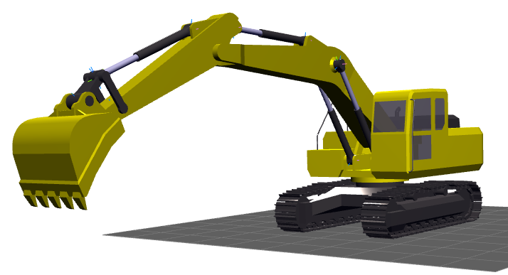
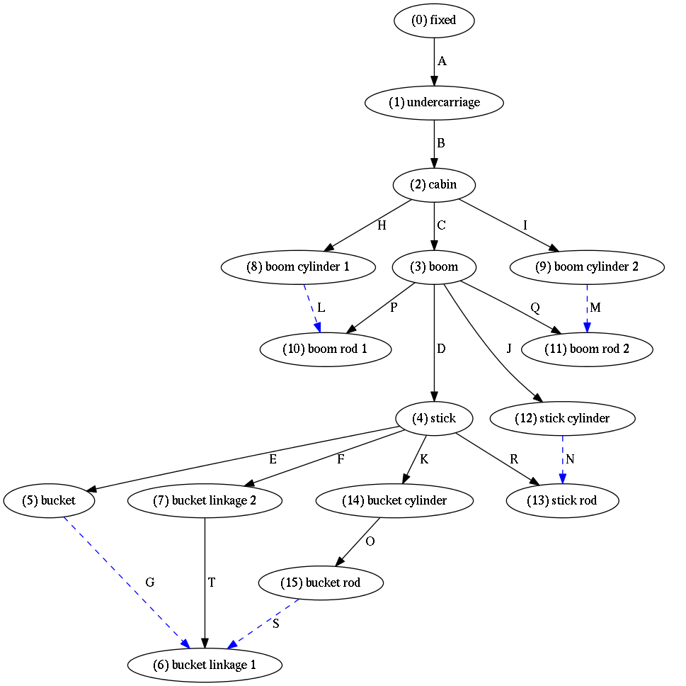
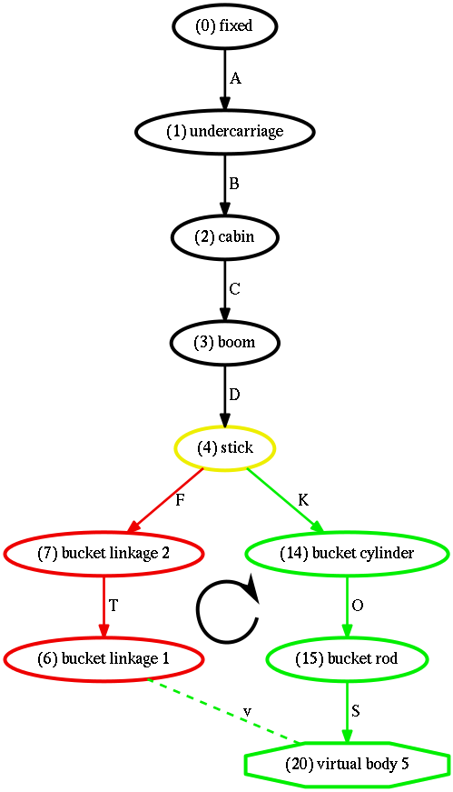
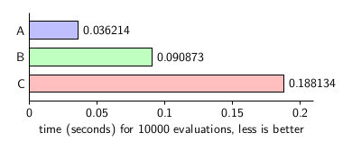
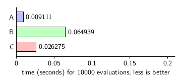

.. title:: Kinematic Substructuring

.. _kinematic_substructuring:

Kinematic Substructuring
========================

In the previous section, a compact formulation of the equations of motion was derived and an efficient solution method was discussed. One bottleneck in the solution process is the Gaussian Elimination with Complete Pivoting (GECP) algorithm itself, which is a triple-loop procedure requiring :math:`r(6mn - 3(m+n)r + 2r^2)/3` FLOPS, where :math:`m` is the number of rows, :math:`n` is the number of columns and :math:`r` is the rank of the matrix. Furthermore, GECP requires both row and column permutations during factorization, which necessitates non-unit stride vector copies, which is not optimal for memory access. Note that other algorithms have been proposed for the automatic identification of independent and dependent variables, for example, based on Singular Value Decomposition (SVD) :cite:`mani1985,wehage1993` or Congruency Transformations :cite:`loduha1995`. Note that the run--time of these alternative methods is increased over GECP; for example, SVD requires :math:`4m^2n+22n^3` FLOPS using the R-SVD algorithm :cite:`golub1996matrix`.

Although the modified GECP algorithm is more efficient than alternative partitioning strategies, due to its :math:`\mathcal{O}(n^3)` complexity and memory access requirements, calling the GECP algorithm should be avoided whenever possible. Certainly, one strategy to improve performance would be to call GECP only once at the beginning of a program's execution. As kinematic bifurcations are common in even relatively simple mechanisms and the primary system of constraints are subject to change, this approach comes at the expense of robustness and is not recommended. Alternatively, one could conservatively call GECP at every time step---and pay a substantial performance penalty. Other approaches call GECP at regular intervals or use a heuristic method to determine when to repartition the Jacobian matrix. Regardless of the specific method used, the robust numerical solution of dynamic equations may require performing GECP many times in the course of a simulation, and strategies to improve GECP algorithm performance are important.

Block--diagonalization is a well--known technique for breaking a large system of equations into smaller, more manageable pieces, thereby increasing computational efficiency. Several algorithms exist in the literature to block partition matrices, such as described in :cite:`acer2011recursive,uccar2007partitioning,steward1965partitioning,aykanat2004permuting,cave2014block`. However, these methods are generally unsuitable for block partitioning mechanism Jacobian matrices because they involve taking linear combinations of variables in addition to row and column permutations; are designed for special--purpose matrices (i.e. square or hermitian); or do not fully uncouple substructures (i.e. the resulting partitioning scheme has overlap or is in single--bordered, K--way form :cite:`aykanat2004permuting`).

.. This chapter introduces a technique to automatically identify and uncouple independent kinematic substructures within a mechanism. After the kinematic substructuring process is complete, the Jacobian matrix will have been permuted to a block--diagonal form, allowing each block submatrix to be processed independently, thereby reducing the overhead of applying the GECP algorithm. In other words, this method takes advantage of the kinematic substructures to block--diagonalize the Jacobian matrix. Throughout this section, kinematic substructuring is applied to a representative example of a complex mechanism, a hydraulic excavator, shown in Fig. :num:`excavator`, which contains five kinematic loops.

.. _excavator:

    A Hydraulic Excavator

Topology
--------

For completeness, the topology of the excavator is described using graph theory :cite:`bondy2008graph,wittenburg2007dynamics`. The preliminary process requires setting up a directed graph that describes how bodies, i.e. nodes, are connected by joints, i.e. edges.  The excavator's incidence matrix, :math:`\Gamma`, is shown in Eq. :eq:`eq:incidence_matrix` below. Manual generation of incidence matrices for complex mechanisms presents a burden to the analyst, and the process is prone to errors; therefore, automated methods are preferred. It is more convenient for an analyst to provide body--joint--body descriptions and shape matrices :cite:`uicker2013`, preferably exported directly from a CAD program. For the present example, the bodies and joints of a hydraulic excavator are provided in an arbitrary, user--defined order as described in the table below. Each body is assigned a unique number, and each joint is assigned a unique letter. As an aid to following the development in this work, the arbitrary letter assigned to each joint has an associated descriptive name shown in Table 1. This name includes an arrow to indicate the user—-defined sense or direction of the joint. Note that the zero identifier is reserved for the fixed inertial reference frame.

.. _table3:

==   ===================== ==  ==============
ID   Body Name             ID  Joint Name
==   ===================== ==  ==============
1    undercarriage         A   fixed :math:`\rightarrow` undercarriage
2    cabin                 B   undercarriage :math:`\rightarrow` cabin
3    boom                  C   cabin :math:`\rightarrow` boom
4    stick                 D   boom  :math:`\rightarrow` stick
5    bucket                E   stick :math:`\rightarrow` bucket
6    bucket linkage 1      F   stick :math:`\rightarrow` bucket linkage 2
7    bucket linkage 2      G   bucket :math:`\rightarrow` bucket linkage 1
8    boom cylinder 1       H   cabin :math:`\rightarrow` boom cylinder 1
9    boom cylinder 2       I   cabin :math:`\rightarrow` boom cylinder 2
10   boom rod 1            J   boom  :math:`\rightarrow` stick cylinder
11   boom rod 2            K   stick :math:`\rightarrow` bucket cylinder
12   stick cylinder        L   boom cylinder 1 :math:`\rightarrow` boom rod 1
13   stick rod             M   boom cylinder 2 :math:`\rightarrow` boom rod 2
14   bucket cylinder       N   stick cylinder :math:`\rightarrow` stick rod
15   bucket rod            O   bucket cylinder :math:`\rightarrow` bucket rod
\    \                     P   boom rod 1 :math:`\rightarrow` boom
\    \                     Q   boom rod 2 :math:`\rightarrow` boom
\    \                     R   stick rod :math:`\rightarrow` stick
\    \                     S   bucket rod :math:`\rightarrow` bucket linkage 1
\    \                     T   bucket linkage 1 :math:`\rightarrow` bucket linkage 2
==   ===================== ==  ==============

From the body--joint--body information in Table :ref:`_table3`, the incidence matrix for the excavator is given in Eq. :eq:`eq:incidence_matrix`. Zeros are removed from sparse matrices to improve view clarity.

.. math::
    :label: eq:incidence_matrix

    \scriptsize
    \Gamma^T =
    \begin{array}{ll}
    \begin{array}{r|rrrrrrrrrrrrrrr}
       &  0 & 1  & 2  & 3  & 4  & 5  & 6  & 7  & 8  & 9  & 10  & 11 & 12 & 13 & 14 & 15\\
       \hline
    A  & -1 & 1  &    &    &    &    &    &    &    &    &    &    &    &    &    &  \\
    B  &    & -1 & 1  &    &    &    &    &    &    &    &    &    &    &    &    &  \\
    C  &    &    & -1 & 1  &    &    &    &    &    &    &    &    &    &    &    &  \\
    D  &    &    &    & -1 & 1  &    &    &    &    &    &    &    &    &    &    &  \\
    E  &    &    &    &    & -1 & 1  &    &    &    &    &    &    &    &    &    &  \\
    F  &    &    &    &    & -1 &    &    & 1  &    &    &    &    &    &    &    &  \\
    G  &    &    &    &    &    & -1 & 1  &    &    &    &    &    &    &    &    &  \\
    H  &    &    & -1 &    &    &    &    &    & 1  &    &    &    &    &    &    &  \\
    I  &    &    & -1 &    &    &    &    &    &    & 1  &    &    &    &    &    &  \\
    J  &    &    &    & -1 &    &    &    &    &    &    &    &    & 1  &    &    &  \\
    K  &    &    &    &    & -1 &    &    &    &    &    &    &    &    &    & 1  &  \\
    L  &    &    &    &    &    &    &    &    & -1 &    & 1  &    &    &    &    &  \\
    M  &    &    &    &    &    &    &    &    &    & -1 &    & 1  &    &    &    &  \\
    N  &    &    &    &    &    &    &    &    &    &    &    &    & -1 & 1  &    &  \\
    O  &    &    &    &    &    &    &    &    &    &    &    &    &    &    & -1 & 1\\
    P  &    &    &    & 1  &    &    &    &    &    &    & -1 &    &    &    &    &  \\
    Q  &    &    &    & 1  &    &    &    &    &    &    &    & -1 &    &    &    &  \\
    R  &    &    &    &    & 1  &    &    &    &    &    &    &    &    & -1 &    &  \\
    S  &    &    &    &    &    &    & 1  &    &    &    &    &    &    &    &    & -1\\
    T  &    &    &    &    &    &    & -1 & 1  &    &    &    &    &    &    &    &
    \end{array}
    \end{array}

The subset of graph edges containing all nodes, but no loops, i.e. the *spanning tree*, is identified by permuting Eq. :eq:`eq:incidence_matrix` to reduced-row echelon form as:

.. math::
    :label: eq:incidence_matrix_no_substructures

    \scriptsize
    \Gamma^T =
    \begin{array}{r|rrrrrrrrrrrrrrr}
       & 1  & 2  & 3  & 8  & 9  & 11 & 4  & 10 & 12 & 13 & 7  & 5  & 14 & 6  & 15\\
       \hline
    A  & 1  &    &    &    &    &    &    &    &    &    &    &    &    &    &   \\
    B  & -1 & 1  &    &    &    &    &    &    &    &    &    &    &    &    &   \\
    C  &    & -1 & 1  &    &    &    &    &    &    &    &    &    &    &    &   \\
    H  &    & -1 &    & 1  &    &    &    &    &    &    &    &    &    &    &   \\
    I  &    & -1 &    &    & 1  &    &    &    &    &    &    &    &    &    &   \\
    Q  &    &    & -1 &    &    & 1  &    &    &    &    &    &    &    &    &   \\
    D  &    &    & -1 &    &    &    & 1  &    &    &    &    &    &    &    &   \\
    P  &    &    & -1 &    &    &    &    & 1  &    &    &    &    &    &    &   \\
    J  &    &    & -1 &    &    &    &    &    & 1  &    &    &    &    &    &   \\
    R  &    &    &    &    &    &    & -1 &    &    & 1  &    &    &    &    &   \\
    F  &    &    &    &    &    &    & -1 &    &    &    & 1  &    &    &    &   \\
    E  &    &    &    &    &    &    & -1 &    &    &    &    & 1  &    &    &   \\
    K  &    &    &    &    &    &    & -1 &    &    &    &    &    & 1  &    &   \\
    T  &    &    &    &    &    &    &    &    &    &    & -1 &    &    & 1  &   \\
    O  &    &    &    &    &    &    &    &    &    &    &    &    & -1 &    &  1\\
    \hdashline
    L  &    &    &    & -1 &    &    &    & 1  &    &    &    &    &    &    &   \\
    M  &    &    &    &    & -1 &  1 &    &    &    &    &    &    &    &    &   \\
    N  &    &    &    &    &    &    &    &    & -1 & 1  &    &    &    &    &   \\
    G  &    &    &    &    &    &    &    &    &    &    &    & -1 &    & 1  &   \\
    S  &    &    &    &    &    &    &    &    &    &    &    &    &    & 1  & -1
    \end{array}

The graph edges above the dashed line in Eq. :eq:`eq:incidence_matrix_no_substructures` comprise the arcs of the directed graph and form the spanning tree of the mechanism. The arcs represent the row--space of :math:`\Gamma ^T`. The remaining edges required to reconnect the spanning tree comprise the chords of the directed graph. Consequently, the number of chords is equal to the number of independent loops in the directed graph :cite:`uicker2013`.

.. The sense of joints P, Q, R and T have been reversed to align with the spanning tree and obtain positive entries on the diagonal of :math:`\Gamma^T`. The upper block has been converted to lower triangular form with 1s along the diagonal. Note that there is not a unique choice of arcs and chords in a given mechanism. In the present example, the permutations were chosen to maximize the breadth of the spanning tree. The spanning tree is visualized in Fig. :num:`spanningtree` . The solid black arrows correspond to the joints that form the arcs in the mechanism, and the dashed blue arrows correspond to the chords.

.. _spanningtree:

    Spanning tree of hydraulic excavator

Using the method described in the previous section, the Jacobian matrix can be found from the Eq. :eq:`eq:incidence_matrix_no_substructures` as:

.. math::
    :label: eq:jacobian1

    \tiny
    J =
    \begin{array}{r|rrrrrrrrrrrrrrrrrrrr}
        & A & B    & C    & H   & I   &  Q   &  D   & P    &  J   &  R   &  F   &  E   &  K   &  T   &  O   & L   & M & N & G & S\\
    \hline
    i &     &   & -h_C & h_H &     &      &      & -h_P &      &      &      &      &      &      &      & h_L &   &   &   &  \\
    ii &    &      & -h_C   &     & h_I & -h_Q &      &      &      &      &      &      &      &      &      &     & h_M &   &   &  \\
    iii &   &      &      &     &     &      & -h_D &      &  h_J & -h_R &      &      &      &      &      &     &   & h_N &   &  \\
    iv  &   &      &      &     &     &      &      &      &      &      & -h_F &  h_E &      & -h_T &      &     &   &   & h_G &  \\
    v &     &      &      &     &     &      &      &      &      &      & -h_F &      &  h_K & -h_T &  h_O &     &   &   &   & h_S
    \end{array}

where the :math:`h_j` are :math:`6\times1` influence coefficient matrices for each of the respective joints. The block row identifier labels, i through v, correspond to a minimal set of kinematic loops in the mechanism, where the number of loops is equal to the number of chords in the directed graph.

Kinematic Substructuring Algorithm
----------------------------------

At this point in the analysis, information regarding the system topology required to solve Eq. :eq:`eq:lagrange_eqn` has been determined. Performing GECP on Eq. :eq:`eq:jacobian1` would require 9000 FLOPs, assuming the Jacobian matrix has full--row rank (i.e :math:`m=30`, :math:`n=20` and :math:`r=15`). In the following section, it will be shown how kinematic substructures can be *automatically* identified and uncoupled, allowing for an increase in computational efficiency.

The kinematic substructuring algorithm requires traversing the directed graph of the mechanism, and the spanning tree is an essential tool for this purpose. Note, however, that the spanning tree contains only the subset of user--defined joints that were classified as arcs in the previous section. A simple modification to Eq. :eq:`eq:incidence_matrix_no_substructures` will effectively convert all user--defined joints to arcs of the directed graph, which is useful in the following discussion. Cut the child-side Cartesian frame of each chord joint from its embedding body and consider this released frame as a *virtual*, massless body. Each chord joint will then have its own unique child body and will become an integral part of an expanded spanning tree. This process will have effectively cut open all kinematic loops and replaced all chords by arcs. For each virtual body, six chord--loop constraint equations are then imposed to connect the virtual body back to its original embedding body.

In the excavator example, the child--side frames of the five chord joints are cut from their embedding bodies and converted into virtual, massless bodies. The virtual bodies are then constrained so that their position, orientation, velocity, and acceleration match the node locations in the respective embedding bodies from which they were cut. With this modification, the chords of the directed graph have been converted to rigid constraints. This simple modification requires no changes to Eq. :eq:`eq:jacobian1`. When the chord loops are cut, the virtual body number and the original chord's embedding (positively oriented) body id are recorded for later reuse. `Table 1`_ shows this information for the hydraulic excavator model.

.. _Table 1:

.. list-table:: Table 1: Virtual and embedding body id for each kinematic loop
    :header-rows: 1

    * - loop id
      - virtual body id
      - embedding body id
    * - i
      - 16
      - 10
    * - ii
      - 17
      - 13
    * - iii
      - 18
      - 13
    * - iv
      - 19
      - 6
    * - v
      - 20
      - 6

A new spanning tree, modified to include the virtual bodies, is shown in Fig. . The solid arrows correspond to the joints that form the arcs in the mechanism, and the dashed lines correspond to the new constraints imposed. Virtual, massless bodies are designated by octagons.

While the incidence matrix in Eq. :eq:`eq:incidence_matrix_no_substructures` provides all the necessary information for traversing the directed graph, navigating through its many ones and zeros may be cumbersome. To avoid this problem the excavator's graph may also be represented more compactly as a parent--child list and binary tree :cite:`cormen2009introduction`. The parent--child list facilitates traversal from any node of the spanning tree upward, toward the root element. The index into the parent--child list, :math:`P`, is each body or node's unique ID number, and the value at that index is the node's unique parent node ID number.  A binary tree facilitates traversal of the graph from any node of the directed graph away from the root element, towards the leaves of the spanning tree. Two lists, :math:`L` and :math:`R`, are used to represent the binary tree. The first list, :math:`L`, is called the *left* or *descendent* list and contains the index of each node's first descendant node, if present. The second list, :math:`R`, is called the *right* or *sibling* list and contains the node's first sibling, if present. Additionally, an *index* list contains the body indices in original user--defined order. For the excavator model, the four lists are shown in `Table 2`_.

.. _Table 2:

.. csv-table:: Table 2: Binary Tree and Parent Child list for excavator
    :header-rows: 1

    "index", 0, 1, 2, 3, 4, 5, 6, 7, 8, 9, 10, 11, 12, 13, 14, 15, 16, 17, 18, 19, 20
    "P", -1, 0, 1, 2, 3, 4, 7, 4, 2, 2, 3, 3, 3, 4, 4, 14, 8, 9 , 12, 5, 15
    "L", 1, 2, 3, 4, 5, 19, 0, 6, 16, 17, 0, 0, 18, 0, 15, 20, 0, 0, 0, 0, 0
    "R", 0, 0, 0, 8, 10, 7, 0, 13, 9, 0, 11, 12, 0, 14, 0, 0, 0, 0, 0, 0, 0

The kinematic substructuring process is divided into the following five steps:

Identify the level of each node in the spanning tree
****************************************************

Using the parent--child list and binary tree, the increasing level of each body in the spanning tree, moving away from the fixed inertial reference frame, is identified and stored in a node--level list. The parent--child list allows one to easily determine if node :math:`k` is in the kinematic path of node :math:`j` using `Algorithm 1`_:

.. code-block:: python
    :caption: Algorithm 1: inPath(j, k, P)
    :name: Algorithm 1

    def inPath(j, k, P):
      while(j > 0):
        if j is k:
          return true:
        j = P[j]
      return false

Using an iterative preorder binary tree traversal :cite:`cormen2009introduction` and a temporary stack variable, :math:`S`, a :math:`levels` list can be generated. The :math:`levels` list is of equal length to the :math:`index` list introduced above. In the following algorithm descriptions, list manipulation is described as follows: :code:`list.pop()` indicates removing an element from the end of the list, and :code:`list.pop(j)` indicates removing an element from the list at the specified index, :math:`j`. Similarly, :code:`list.append(1)` indicates appending the value :math:`1` to the end of the :math:`list`. All pseudocode is described using the C/python programming convention for indexing. Therefore, :code:`list.pop(0)` indicates removing the first element from the list. Additionally, :code:`list[1:end]` represents a subset of the :math:`list` containing elements from the second value up to and including the last element.

.. code-block:: python
    :caption: Algorithm 2: detectLevels(P, L, R)
    :name: Algorithm 2

    def detectLevels(P, L, R):
      S = []
      levels = [0]
      k = L[0]
      while(S or k > 0):
        if k>0:
          levels[k] = levels[P[k]] + 1
          if R[k] > 0:
            S.append(R[k])
          k = L[k]
        else:
          k = S.pop()
      return levels

The :math:`levels` list for the excavator model is shown in `Table 3`_.

.. _Table 3:

.. csv-table:: Table 3: Levels list
    :header-rows: 1

    "index", 0, 1, 2, 3, 4, 5, 6, 7, 8, 9, 10, 11, 12, 13, 14, 15, 16, 17, 18, 19, 20
    "levels", 0, 1, 2, 3, 4, 5, 6, 5, 3, 3, 4, 4, 4, 5, 5, 6, 4, 4, 5, 6, 7

Identify loop members
*********************

.. Each loop's *base* node and the nodes in the loop can also be readily identified from the parent--child list and `Table 2`_. Let the respective kinematic paths from the spanning tree's root to each chord joint's virtual body and its user--defined embedding body represent the positive and negative branch segments of the loop, as shown for loop v in Fig. :num:`loopv` below. In Fig. :num:`loopv`, edges F and T are oriented negatively with respect to the loop direction, edges K, O and S are oriented positively with respect to the loop direction, node 4 is loop v's unique base node, and nodes 0, 1, 2 and 3 are in the ancestor path of node 4. From `Table 2`_, let the *virtual body id* for loop :math:`j` be stored in :code:`positiveNodes[j]` and the corresponding *embedding body id* stored in :code:`negativeNodes[j]`.

For each grouping in `Table 2`_, each loop's members can be identified using `Algorithm 3`_ below and stored in the list :math:`members`, an initially empty list of lists equal to the number of chord loops, i-v. The first and second while loops are used to decrement each node index in the kinematic path until node indices in the positive and negative branches of the loop are at the same level in the spanning tree. Once the decremented node indices have reached the same level, they will be decremented together by level until the loop's unique *base node* is identified. During this process, the node indices are stored in the corresponding list. At the end of the process, the last node index that was pushed to list is removed, as the base node will have been written twice, and the sequence of the nodes is reversed. The final :math:`members` list contains each loop's base node first, followed by the loop members in monotonically increasing level order.

.. code-block:: python
    :caption: Algorithm 3: detectLoopMembers(P, levels, loopCount, negativeNodes, positiveNodes)
    :name: Algorithm 3

    def detectLoopMembers(P, levels, loopCount, negativeNodes, positiveNodes):
      loopMembers = [[] for j in range(loopCount)]
      for j in range(loopCount):
        negative = negativeNodes[j]
        positive = positiveNodes[j]
        loopMembers[j].append(negative)
        loopMembers[j].append(positive)
        while levels[positive] > levels[negative]:
          positive = P[positive]
          loopMembers[j].append(positive)
        while levels[negative] > levels[positive]:
          negative = P[negative]
          loopMembers[j].append(negative)
        while positive is not negative:
          negative = P[negative]
          positive = P[positive]
          loopMembers[j].append(negative)
          loopMembers[j].append(positive)
        loopMembers[j].pop()
        loopMembers[j].reverse()
      return loopMembers

.. _loopv:

    Loop v members and nodes in kinematic path of loop v's base node.

Order loops by level
********************

At this point the loops are rearranged by sorting their base nodes into monotonically increasing order by level in the spanning trees. After processing by `Algorithm 2`_ and sorting, the loop ordering sequence and loop member lists are shown in `Table 4`_.

.. _Table 4:

.. csv-table:: Table 4: Members of each kinematic loop with loops listed in monotonically increasing order by level in the spanning tree. The base node associated with each loop is the first member of each list.
    :header-rows: 1

    "loop ID", "base node", "loop members"
    i, 2, "2, 3, 8, 10, 16"
    ii, 2, "2, 3, 9, 11, 17"
    iii, 3, "3, 4, 12, 13, 18"
    iv, 4, "4, 7, 5, 6, 19"
    v, 4, "4, 7, 14, 15, 6, 20"

In the excavator example, no reordering of the loops was necessary, as their base nodes were already arranged by monotonically increasing level order.

Merge loops into kinematic substructures
*****************************************

Any given mechanism will consist of at least one kinematic substructure, i.e. the entire mechanism. Therefore, the loop--merging process begins by assigning the first loop, i, to the first substructure. Each successive loop is then inspected to determine if it should be added to any of the existing kinematic substructures or if the loop should be assigned to a new substructure.

A candidate chord--loop will be merged with a kinematic substructure if the substructure and the merge candidate have at least one body and one joint in common. Note, however, that the graph edge (joint) labels are not required for merging. The merging process can be performed using only the parent--child list and loop member assignments. A candidate loop will be merged with a kinematic substructure if the substructure's base node matches the candidate's base node or if it is in the candidate base node's ancestor path, and if the candidate loop and substructure have at least one descendant node in common. The term descendant node refers to any loop member that is not the loop's base node, i.e. the subset of loop members, :code:`loop[1:end]`. This applies to kinematic substructures as well, where :code:`loop[1:end]` is the union of all merged chord-loop bodies, excluding the unique base body at the lowest level in the spanning tree.

.. code-block:: python
    :caption: Algorithm 4: detectSubstructures(loopMembers, P)
    :name: Algorithm 4

    def detectSubstructures(loopMembers, P):
      substructures = [[]]
      substructures[0].append(loopMembers.pop(0))
      while(loopMembers):
        mergeCandidate = loopMembers.pop(0)
        merge = false
        for substructure in substructures:
          if inPath(mergeCandidate[0], loop[0], P):
            if any(mergeCandidate[1:end] in loop[1:end]):
              substructure.append(mergeCandidate)
              merge = true
              break
          if merge:
            break
        if not merge:
          substructures.append([mergeCandidate])
      return substructures

In the present example, the base node of loop i is found to be in the ancestor path of loop ii's base node. Inspecting the descendant members of loop ii reveals that node 3 is also a child of loop i, indicating that loop ii should be merged into the first kinematic substructure.

Moving on to loop iii, an ancestor of loop iii's base node is found to be the base node of the first kinematic substructure.  However, none of the descendant members of loop iii are members of loops i or ii, and therefore loop iii *is not* a member of the first kinematic substructure. Thus loop iii is assigned to a second kinematic substructure.

Loops iv and v are then analyzed. An ancestor of the base node of loop iv is found to be in the kinematic path of the base node of loops i and ii in the first kinematic substructure, however, none of the children of loop iv's base node is a member of loops i and ii. Therefore, loop iv is not a member of the first substructure. Similarly loop iv is not a member of the second substructure. Thus a third substructure is designated, to which loop iv is assigned. Similarly, loop v is not a member of the first and second substructures. However, one child of loop v's base node is a member of the third substructure, so loop v is assigned to it. The substructures and their corresponding loops are shown in `Table 5`_.

.. _Table 5:

.. csv-table:: Table 5: Kinematic substructures and their corresponding chord--loops
    :header-rows: 1

    "substructure", "loops"
    1, "i, ii"
    2, "iii"
    3, "iv, v"

Reorder bodies and joints
*************************

In this last step the joints are ordered by level in the spanning tree and permuted according to their kinematic substructure assignments, which requires creating a *short list* of bodies that are either:

* not a member of any kinematic substructure, or
* are the base node of a kinematic substructure

In the excavator example, the short list of bodies, ordered by level in the spanning tree becomes: (0) fixed, (1) undercarriage, (2) cabin, (3) boom, and (4) stick. From the bodies list, a short list of joints is also created. Each joint in the joint short list is the parent joint associated with the corresponding body in the body short list. The (0) fixed body has no parent, so the joints in the joint short list for the present example are: A, B, C, and D.

From the joint short list, an *expanded joint list* is created. For each joint in the joint short list, perform the following operations:

* if the joint is not a member of a kinematic substructure, append the joint to the expanded joint list, otherwise:
* append the joint associated with the base node of the kinematic substructure to the expanded joint list only if it has not been appended in a previous step.  Then, append the remaining joints associated with nodes in the kinematic substructure, ordered by level in the spanning tree.

After the final sorting and expansion operation, the revised Jacobian matrix becomes

.. math::
    :label: eq:jacobian2

    \tiny
    J=
    \begin{array}{l|rrrrrrrrrrrrrrrrrrrr}
        & A & B    & C    & H   & I   &  Q    &P    & L   & M   &  D   &  J   &  R   & N   &  F   &  E   &  K   &  T   &  O   & G   & S\\
    \hline
    i &     &      & -h_C & h_H &     &       &-h_P & h_L &     &      &      &      &     &      &      &      &      &      &     &  \\
    ii &    &      & -h_C &     & h_I & -h_Q  &     &     & h_M &      &      &      &     &      &      &      &      &      &     &  \\
    iii &   &      &      &     &     &       &     &     &     & -h_D &  h_J & -h_R & h_N &      &      &      &      &      &     &  \\
    iv  &   &      &      &     &     &       &     &     &     &      &      &      &     & -h_F &  h_E &      & -h_T &      & h_G &  \\
    v &     &      &      &     &     &       &     &     &     &      &      &      &     & -h_F &      &  h_K & -h_T &  h_O &     & h_S\\
    \end{array}

and the block submatrices :math:`J_1` -- :math:`J_3` associated with each kinematic substructure are:

.. math::
    :label: eq:jacobian2_1

    J_1 = \begin{array}{l|rrrrrrr}
      & C    & H   & I   &  Q    &P    & L   & M\\
      \hline
    i &-h_C & h_H &     &       &-h_P & h_L \\
    ii &-h_C &     & h_I & -h_Q  &     &     & h_M
    \end{array}

.. math::
    :label: eq:jacobian2_2

    J_2=
    \begin{array}{l|rrrr}
        & D   &  J   &  R   & N   \\
        \hline
        iii &-h_D &  h_J & -h_R & h_N
    \end{array}

and

.. math::
    :label: eq:jacobian2_3

    J_3=
    \begin{array}{l|rrrrrrr}
        &  F   &  E   &  K   &  T   &  O   & G   & S\\
        \hline
    iv  &-h_F &  h_E &      & -h_T &      & h_G &  \\
    v &-h_F &      &  h_K & -h_T &  h_O &     & h_S
    \end{array}

.. The permuted Jacobian matrix in Eq. :eq:`eq:jacobian2` now shows the block--diagonalized structure. Joints A and B are not in any substructure and are therefore always independent. Chord loops i and ii and joints C, H, I, Q, P, L and M comprise kinematic substructure 1, chord loop iii and joints D, J, R, and N comprise kinematic substructure 2, and chord loops iv and v and joints F, E, K, T, O, G and S comprise substructure 3. The revised spanning tree shown in Fig. :num:`spanningtree2` has been assigned colors according to the kinematic substructure assignments: (Red: Substructure 1, Green: Substructure 2, and Blue: Substructure 3). The arcs, chords, and nodes are colored according to which kinematic substructure they appear in, with the exception that base nodes are colored according to their associated kinematic substructures. Likewise, labels :math:`J_1`, :math:`J_{2}` and :math:`J_{3}` are assigned to each of the respective Jacobian submatrices.

GECP can then be applied independently to each of the Jacobian submatrices. Assuming that each Jacobian submatrix has full row rank, GECP would require a total of 1008 FLOPs, an approximate order of magnitude reduction in floating point operations. As the operations count is not always a direct measure of numerical efficiency, in the next section a numerical experiment is carried out to compare the kinematic substructuring technique to other methods.

.. _spanningtree2:

.. figure:: figures/digraph_w_constraints.png

    Modified spanning tree for hydraulic excavator with chords converted to arcs

Although the process for automatically determining kinematic substructures is described in specific context to mechanisms, the substructuring algorithm is a general graph partitioning method that may have applications in other disciplines. To facilitate transposition to other subject areas, note that the Jacobian matrix, :math:`J`, is a byproduct of the right null space of the directed graph, :math:`\Gamma^T`. The right null space of the directed graph is also referred to as the loop or circuit matrix in the literature. Therefore, the methods described in this section may be adapted to other subjects by replacing any reference to the Jacobian matrix with the more general loop matrix.

Numerical Experiment
--------------------

To investigate the numerical efficiency of kinematic substructuring, GECP of the block--diagonalized Jacobian matrix in Eq. :eq:`eq:jacobian2` is computed using (a) the kinematic substructuring method applied to each of the three block submatrices, :math:`J_1`--:math:`J_3`, (b) the sparse matrix algebra MA48 factorization algorithm (part of the Harwell Subroutine Library (HSL) :cite:`duff1996design` applied only to the nonzero terms of the :math:`30\times 20` Jacobian matrix, :math:`J` and (c) the full, dense matrix algebra applied to the full :math:`30\times 20` Jacobian matrix, :math:`J`.

In sparse matrix methods, only the non--zero terms of the coefficient matrices are stored. Therefore, memory usage and floating point operations required to carry out sparse-matrix algebra is reduced compared to full, dense algebra. Indeed, many large scientific problems, such as the numerical solution of finite element analysis (FEA) equations, would be intractable without the use of sparse-matrix methods. Note, however, that in sparse-matrix methods, the set of instructions to perform the operations is more complicated than full, dense matrix algebra. Furthermore, matrix coefficients may not be stored or accessed in contiguous memory, which may increase cache misses :cite:`toledo1997improving`. The use of sparse-matrix algebra is expected to offer little or no benefit when the coefficient matrices are small and/or dense. In contrast to the large, highly sparse equations found in other disciplines, the equations of motion for many multibody systems are typically smaller and moderately sparse. Nonetheless, Gonzalez et al. :cite:`gonzalez2008effect` showed that sparse-matrix methods do offer some performance benefit over full, dense matrix algebra, considering the special structure of dynamics equations, even for small to moderate problem sizes.

Block--diagonalization via kinematic substructuring is essentially a hybrid of full and sparse matrix methods. As discussed in the previous section, full, dense matrix algebra can be applied to each of the Jacobian matrices :math:`J_1`--:math:`J_3` at a small fraction of the operations required to apply full matrix algebra to the entire Jacobian matrix, :math:`J`. Furthermore, these block submatrices are dense, and sparse-matrix algebra is expected to have increased complexity compared to full, dense algebra applied to them individually.

The HSL MA48 factorization algorithm was chosen as the reference sparse implementation because HSL is well--known for its efficient, well--tested, and high--quality numerical algorithms. HSL subroutines are commonly used in many commercial and research--oriented multibody dynamics solvers :cite:`gonzalez2008effect,hidalgo2011high`, and the MA48 algorithm is suitable for nonsymmetric, rectangular matrices.

The HSL MA48 algorithm consists of three primary components. The first *analyze* component analyzes the specific structure of a coefficient matrix and generates an initial factorization. The second *factorize* component is used to compute the factors of a matrix with a known sparsity pattern determined in the *analyze* phase. In *factorize*, a *fast* flag can be set. If the fast flag evaluates to true, the factorization sequence from the previous call to *analyze* or *factorize* is used; if the fast flag evaluates to false, the factorization sequence may change. The third component of HSL MA48 is a *solve* phase, which uses the matrix factors to solve a set of linear equations. For benchmarking purposes, only the first and second components of HSL MA48 are considered.

The *analyze* component of HSL MA48 is analogous to block--diagonalization via kinematic substructuring described above. The *analyze* phase would be called once at the beginning of a simulation for the particular sparsity pattern of the Jacobian matrix. *Analyze* would not be called again unless a pivot has come too close to zero or the system's topology has changed. *Factorize*, with the *fast* flag set to false, is analogous to gaussian elimination with partial pivoting, and *factorize*, with the *fast* flag set to true, is analogous to gaussian elimination without pivoting.

To compare the efficiency of kinematic substructuring to sparse and full matrix factorization, a computer program was written in the C programming language that closely follows the development of this paper. The bodies and joints of the excavator model are specified in an arbitrary user--defined order in a text file. When the program is launched, the bodies and joints are loaded into computer memory using a linked--list data structure. Bodies and joints are permuted according to the kinematic substructing algorithm using memory pointers. Once the permutation process is complete, quantities are copied to contiguous memory, and Newton--Raphson iteration is applied to eliminate constraint errors, if present. Finally, the spanning tree is traversed to update the terms of either (a) the block diagonal submatrices :math:`J_1`--:math:`J_3`, (b) a sparse matrix representation of the Jacobian, or (c) the full dense Jacobian matrix, :math:`J`. Once the terms are computed, the Jacobian matrix is passed to one of the three algorithms for matrix factorization. The Jacobian update and factorization steps are repeated 10000 times for each method.

The numerical experiments were carried out on a 6--core AMD Phenom II X6 1090T Processor with 16GB of RAM, running the 64 bit 3.18.6-1 Arch Linux kernel. The program was compiled using the GNU Compiler Collection (GCC) C compiler, version 4.9.2-4. The HSL MA48 algorithm is used in conjunction with the ATLAS (Automatically Tuned Linear Algebra Software) :cite:`whaley05minimizing` implementation of BLAS (Basic Linear Algebra Subprograms), whereas the GECP algorithm for full, dense matrix factorization was programmed wholly without the use of BLAS. Refer to reference :cite:`gonzalez2008effect` for more details of various BLAS implementations in multibody dynamics.

Results of the experiment are provided in Fig. :num:`runtime1`. Kinematic substructuring provides an approximate :math:`5\times` speedup over full, dense matrix algebra. The speedup is not directly proportional to the :math:`9\times` reduction in FLOPS due to the increased number of function evaluations. Nonetheless the :math:`5\times` speedup represents a considerable savings over full, dense GECP. MA48's performance was between the two methods. Kinematic substructuring was more than two times faster than MA48, even without the use of BLAS.

.. _runtime1:

    Run times for 10000 gaussian elimination evaluations with complete row and column pivoting for A: Block--diagonalization via kinematic substructuring, B: Sparse factorization using HSL MA48 algorithm, and C: Full, dense gaussian elimination

The results depicted in Fig. :num:`runtime1` represent the portion of simulation time required to determine the set of independent and dependent generalized coordinates if GECP were conservatively called at every time step during numerical integration. As discussed in the introduction, GECP need not be called at every time step. If the set of dependent and independent variables remains unchanged between two integration steps, the factorization pivot sequence may be reused. However, it is strongly emphasized that if this approach is taken, for robustness, GECP must be reapplied as the mechanism approaches a bifurcation configuration. In the present example, a heuristic method for monitoring the stability of the choice of dependent and independent variables based on :cite:`mittra1975theuseof` is used to determine when to reapply GECP. The ratio of largest to smallest pivots of the largest nonsingular submatrix of :math:`J` in full, dense GECP or of the block--diagonal matrices :math:`J_1`--:math:`J_3` in block--diagonalized GECP is monitored. If the pivot ratio becomes greater than a user--specified threshold obtained from the initial starting value, then GECP is applied again. The logic to check the pivot ratio is not added to the HSL MA48 *fast factorization* subroutine. Instead, MA48 returns an error when a pivot approaches machine roundoff error during the fast factorization process, which may be used as a basis to call factorization with the *fast* flag set to false again to determine a new set of dependent and independent variables.

.. _runtime2:

    Run times for 10000 gaussian elimination evaluations without pivoting for A: Block--diagonalization via kinematic substructuring, B: Sparse ``fast--factorization'' using HSL MA48 algorithm, and C: Full, dense gaussian elimination without pivoting

When the pivot sequence is reused from the initial call to GECP, block--diagonalization via kinematic substructuring is approximately :math:`7\times` faster than MA48's fast factorize routine, even accounting for the additional check on pivot ratios. The factorization and pivot ratio calculation for the entire full, dense Jacobian was also more than twice as fast as sparse factorization with the *fast* flag set to true.

.. Another implication of using a heuristic method, together with the kinematic substructuring technique, is that when the mechanism approaches a bifurcation configuration, GECP need not be reapplied simultaneously to all three block submatrices, :math:`J_1`--:math:`J_3`. Each kinematic substructure can be monitored individually, and full GECP can be reapplied on an as--needed basis to each submatrix in approximately 1/3 the time indicated in Fig. :num:`runtime1` A. On the other hand, if the mechanism approaches a bifurcation configuration when using full, dense algebra or sparse-matrix methods, GECP must be reapplied to the entire Jacobian matrix, and the time required to identify a new set of dependent and independent variables shown in Figs. :num:`runtime1` B and :num:`runtime1` C will always be roughly the same.

The results of Figs. :num:`runtime1` and :num:`runtime2` indicate that block--diagonalization via kinematic substructuring requires a minimal computational expense to select a set of dependent and independent variables, which is a critical part of a robust solution of dynamics equations. The next section summarizes the role of kinematic substructures in setting up and processing the dynamic equations of motion.
